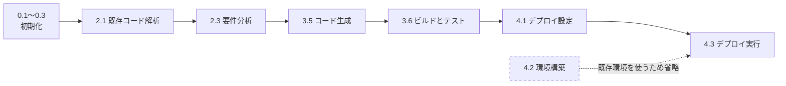
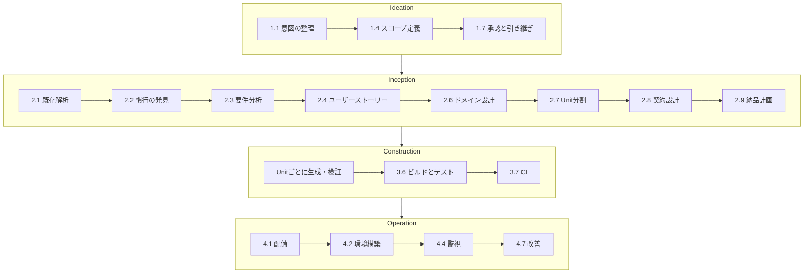

# AI-DLC フォルダ構成と実例

## 概要

AI-DLC（v2 実装、awslabs/aidlc-workflows）が成果物をどのフォルダに置くか、公式ドキュメントの実例（bugfix と feature）で何が出力されるかをまとめる。基本の説明は [AI-DLC入門](ai/AI-DLC入門.md) を参照。

---

## 1. 成果物の置き場所

案件（Intent）ごとに、次のフォルダが作られる。

> **このツリーは公式の図ではない。** 公式ドキュメントの複数のページから、筆者が1枚に合成した。
>
> - **公式の記載どおり**: 基本パス `aidlc/spaces/<space>/intents/<YYMMDD>-<label>/`、案件フォルダ直下の構成（`aidlc-state.md`、`audit/`、`initialization/`、`ideation/`、`inception/`、`construction/`、`verification/`、`project-description.json`）、`requirements.md` のパス、`memory/` と `knowledge/` が `intents/` と同じ階層にあること。案件名 `261013-inventory-rest-api` も公式の例。
> - **要約から読み取った（全文では未確認）**: `inception/user-stories/` の中身、`codekb/` と `intents.json` の位置。
> - **公式の実例に出てくる**: `construction/build-and-test/test-results.md`。
> - **筆者の補完**: 上記を1枚の図に並べたこと。右側のコメントも筆者の説明。
>
> 正確な構成は、実際に `/aidlc` を実行して生成されたフォルダか、[Architecture](https://awslabs.github.io/aidlc-workflows/reference/01-architecture/) と [Your First Workflow](https://awslabs.github.io/aidlc-workflows/guide/02-your-first-workflow/) で確認する。

```text
aidlc/
└── spaces/
    └── default/                          # Space（チームの入れ物）。既定は default
        ├── memory/                       # チームの記憶（Rules）。team.md、project.md
        ├── knowledge/                    # 参照知識
        ├── codekb/<repo>/                # Reverse Engineering の9成果物（既存コードの解析）
        └── intents/
            ├── intents.json              # Intent の登録簿（正式IDは UUIDv7）
            └── 261013-inventory-rest-api/    # = <record>（YYMMDD-ラベル）
                ├── aidlc-state.md        # 進捗（各段階の [x]）
                ├── project-description.json
                ├── audit/                # 監査ログ（clone ごとの断片）
                ├── initialization/
                ├── ideation/
                ├── inception/
                │   ├── requirements-analysis/
                │   │   ├── requirements.md
                │   │   └── requirements-analysis-questions.md
                │   └── user-stories/
                │       ├── stories.md
                │       └── personas.md
                ├── construction/
                │   └── build-and-test/test-results.md
                └── verification/         # フェーズ境界の検証レポート
```

- `<record>` のラベルは kebab-case。同じ日に衝突したら番号が付く。
- フェーズのフォルダは、その scope が実行するフェーズだけ作られる。段階のフォルダは、その段階が最初に成果物を書いたときに作られる。
- 上のツリーの `inception/user-stories/` と `memory/` などの下位構成は、ドキュメントの要約から再構成したもので、全文では確認できていない。

### 主な成果物の場所

| 成果物 | 場所 | 確度 |
|---|---|---|
| `requirements.md` | `<record>/inception/requirements-analysis/` | ドキュメントに記載 |
| `requirements-analysis-questions.md` | 同上 | ドキュメントに記載 |
| `traceability.json`（要件とストーリーの対応） | 同上と `inception/user-stories/` | 要約のみ |
| `stories.md`、`personas.md` | `<record>/inception/user-stories/` | 要約のみ。実例にはファイル名だけ |
| `unit-of-work.md`、`unit-of-work-dependency.md`、`bolt-plan.md` | **フォルダの記載なし**（ファイル名のみ） | 未確認 |
| `aidlc-state.md` | `<record>/` 直下 | ドキュメントに記載 |
| `audit/`、`verification/` | `<record>/` 直下 | ドキュメントに記載 |
| `verification-command.txt`（Unit の検証コマンド） | `<record>/` 直下 | 実例に記載 |
| `test-results.md` | `<record>/construction/build-and-test/` | 実例に記載 |
| デプロイ設定・ログ | `<record>/operation/deployment-pipeline/`、`.../deployment-execution/` | 実例に記載 |
| 既存コードの解析9ファイル | `aidlc/spaces/<space>/codekb/<repo>/` | ドキュメントに記載 |
| チーム慣行 | `<record>/inception/practices-discovery/` → 承認後に `memory/team.md`、`project.md` へ昇格 | ドキュメントに記載 |

### git での扱い

- ドキュメントに記載: `project-description.json` はコミットされる。名前を挙げた文書が git-ignore されていると、コミットされる旨を確認される。git 管理外のプロジェクトでは、変更を戻せるよう `git init` とコミットを勧められる。
- 要約のみ:
  - コミットされる: `memory/**`、`knowledge/**`、`codekb/**`、`intents.json`、各案件の `aidlc-state.md`、`audit/` の断片、成果物
  - git-ignore される: `active-space` と `active-intent`（現在位置の印）、`.aidlc-clone-id`、`.aidlc-sessions/`、`runtime-graph.json` などの派生ファイル
- 監査ログは clone ごとに分割され、同時に追記しても衝突しない。

## 2. 人が編集する場所

質問への答え方は3種類。段階の途中で切り替えられ、選んだ方式は以降の段階でも使われる。

| モード | やり方 |
|---|---|
| Guide me | チャットで数問ずつ、選択肢つきで答える |
| I'll edit the file | エージェントが示す質問ファイルに自分で答えを書き、終わったと伝える |
| Chat | 自由に議論し、エージェントが決定事項を抜き出す |

- 質問は、選択肢のあとに `[Answer]:` を置く形式。最後の選択肢は「X. Other（自由記述）」。
- 空の `[Answer]:` があると先に進めない（要約のみ）。
- 承認ゲートは Approve か Request Changes。変更依頼は自分の言葉で書く。
- 自動で続行しても、計画の承認、検証コマンドの選択、要約の確認は人間が行う。
- `requirements.md` や `stories.md` を直接手で直す運用は、ドキュメントに書かれていない。編集点として書かれているのは、質問ファイルと Request Changes のフィードバック。

## 3. 実例1: bugfix

ユーザー情報 API で、`display_name` が null のとき HTTP 500 になる不具合（プロフィールの約12%が該当）。



- scope: `/aidlc bugfix`。9段階（初期化3 + 6段階）、Minimal の深さ。承認ゲートは6回。
- 検出: Java 17、Spring Boot 3.2、Maven、既存コードあり。
- 質問: 2.3 で「ユーザーにとって、このバグはどのくらい深刻か」（Critical / High / Medium / Low / Other）。答えは High。ほかに、null 時の代替表示（ユーザー名で代用）と、移行なしで穏当に扱うかを聞かれた。
- 回答モード: Guide me。

| 段階 | 出力 |
|---|---|
| 2.1 | `codekb/user-service/` に9ファイル（`business-overview.md`、`architecture.md`、`code-structure.md`、`api-documentation.md`、`component-inventory.md`、`technology-stack.md`、`dependencies.md`、`code-quality-assessment.md`、`reverse-engineering-timestamp.md`） |
| 2.3 | `requirements.md`: 機能要件3件（null の扱い、serializer の修正、代替ロジック）、非機能要件1件（応答時間の劣化なし） |
| 3.5 | 4ステップの計画のあと、`ProfileSerializer.java` と `ProfileService.java` を修正。単体テスト2件と結合テスト2件を追加 |
| 3.6 | `construction/build-and-test/test-results.md`: 89テスト、失敗0、カバレッジ 62% → 64% |
| 4.1、4.3 | CD 設定、ロールバック手順書、デプロイログ、スモークテスト、ヘルスチェック |

最後に `aidlc-state.md` の9段階がすべて `[x]` になる。所要時間は書かれていない。

## 4. 実例2: feature

タスク管理アプリの通知サービス。アプリ内通知と任意のメール要約を、割り当て・期限接近・コメントの3種類で送り、ユーザーごとの設定を持つ。



- scope: `/aidlc feature`、`--collaborators on`（複数のエージェントが貢献する設定）で実行。
- 段階数: ドキュメントの表は33段階、実行時のメッセージは「30段階、承認30回」と書き、両者は一致していない。省かれた段階の名前も書かれていない。
- 技術: TypeScript、Node.js 20、Express、PostgreSQL。既存のタスク・ユーザーのサービスがある。

| 段階 | 出力 |
|---|---|
| 1.1 | `intent-capture-questions.md`、`intent-statement.md`、`stakeholder-map.md`。範囲は「アプリ内とメール」に決定 |
| 1.4 | `scope-document.md`、`intent-backlog.md`。範囲外はプッシュ通知、SMS、リアルタイム WebSocket |
| 2.2 | `team-practices.md`、`discovered-rules.md`、`evidence.md`。承認後に memory へ昇格 |
| 2.3 | 機能要件12件、非機能要件5件（例: 配信遅延5秒以内）。メール送信失敗時の扱いと、要約の頻度を質問された |
| 2.4 | `personas.md`、`stories.md`（複数エージェントによる mob） |
| 2.6 | `components.md`、`decisions.md`。部品は NotificationService、PreferenceService、EmailRenderer、DigestScheduler |
| 2.7 | Unit は3つ: `notification-core`、`notification-preferences`、`notification-email` |
| 2.8、2.9 | `contract-summary.md`、`bolt-plan.md`、`risk-and-sequencing-rationale.md`、`external-dependency-map.md`。検証コマンドは `bun run verify:notifications` |
| 3.x | 「自動で続行」を選択。Unit ごとにソースとテストを生成し、`verify` を実行。3.6 は47テスト成功、カバレッジ 78%。3.7 の CI ゲートはカバレッジ 75% 以上と重大な脆弱性なし |
| 4.x | blue-green 配備、SQS・SES・DynamoDB の構築、CloudWatch のダッシュボードとアラーム、SLO（アプリ内 99.9%、メール 99%・30秒以内） |

承認ゲートは、Unit ごとのチェックポイントも含め、明示的な Approve が必要だった。所要時間は書かれていない。

## 5. Inception の入出力: 2.3 と 2.4

| | 2.3 Requirements Analysis | 2.4 User Stories |
|---|---|---|
| 担当 | プロダクト担当エージェント。inline | プロダクト担当（主）、デザイン・開発・品質の各エージェント（支援）。mob |
| 実行条件 | 必ず実行。深さは scope で変わる | ユーザー向け機能、複数のペルソナ、複雑なロジック、チーム横断のとき。純粋なリファクタ、孤立した不具合修正、インフラのみ、開発者向けツールでは省く |
| 入力 | 既存コードの解析成果物、プロジェクト概要、Ideation の意図とスコープ文書、チーム慣行 | `requirements.md`、既存コードの解析成果物 |
| 出力 | `requirements.md`、`requirements-analysis-questions.md`、`traceability.json`。要件IDは FR・NFR の連番 | `stories.md`、`personas.md`、`user-stories-assessment.md`、`traceability.json`、`user-stories-questions.md`、各エージェントの貢献ファイル |
| 承認 | 空の `[Answer]:` があると進めない。曖昧さと矛盾を確認する | collaborators が on のとき、3つの貢献を統合するまで承認できない |

- 2.4 は、collaborators が off だと mob の工程を省く。出荷時に on なのは `enterprise` だけ。
- MoSCoW は優先度の目安で、MVP の境界は 2.9 で決まる。
- 2.3 以外の細部は、ドキュメントの要約から読み取ったもので、全文では確認できていない。

## 6. 取り入れるときの目安（筆者の案）

- 最初は、段階の少ない scope（`bugfix`、`express`、`poc`）で1件回し、成果物が自分のリポジトリにどう残るかを見る。
- `aidlc/` フォルダは、記憶と成果物を含めて git に入れる前提の作り。置き場所と ignore 設定を、チームで先に決める。
- 手で直したい文書があっても、直接の編集は想定されていない。質問ファイルと Request Changes で直す運用になる。
- ユーザーストーリーだけ使うなら、`requirements.md` → `stories.md` の2.3〜2.4 が対象。

## 参考リンク

- [Worked Examples（実例: bugfix と feature。3章・4章の元）](https://awslabs.github.io/aidlc-workflows/guide/16-worked-examples/)
- [Your First Workflow（案件フォルダ直下の構成、回答モード、git の扱い。1章・2章の元）](https://awslabs.github.io/aidlc-workflows/guide/02-your-first-workflow/)
- [Inception Stage Reference（`requirements.md` のパス、2.3 と 2.4 の入出力。1章・5章の元）](https://awslabs.github.io/aidlc-workflows/reference/04-stages/inception/)
- [Architecture（`memory/`、`knowledge/`、`codekb/` の位置、git 管理の対象。1章の元）](https://awslabs.github.io/aidlc-workflows/reference/01-architecture/)
- [Phases and Stages（各段階の成果物の一覧）](https://awslabs.github.io/aidlc-workflows/guide/04-phases-and-stages/)
- [awslabs/aidlc-workflows（リポジトリ）](https://github.com/awslabs/aidlc-workflows)
