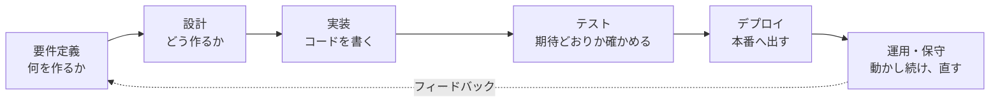
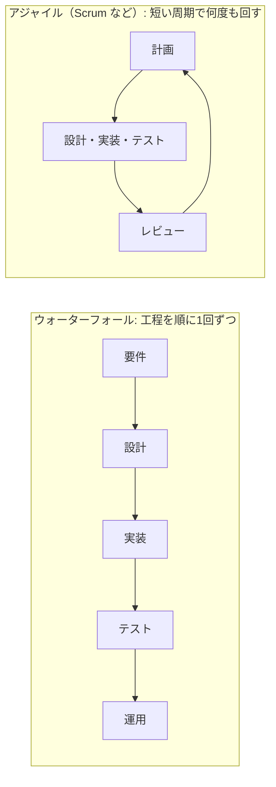
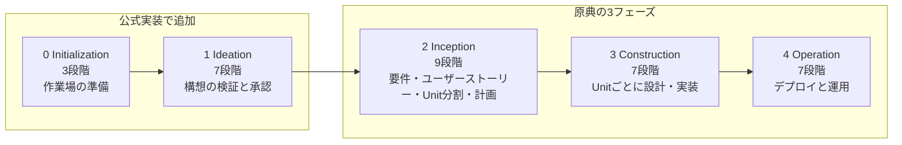
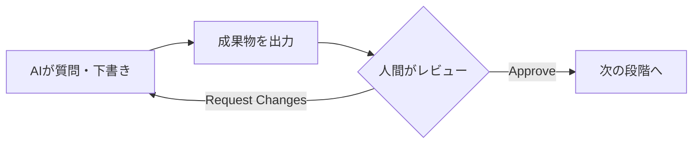
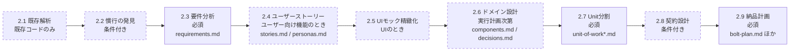
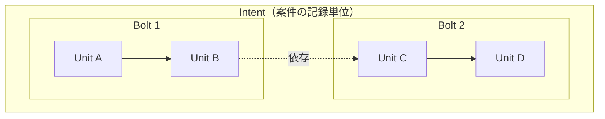
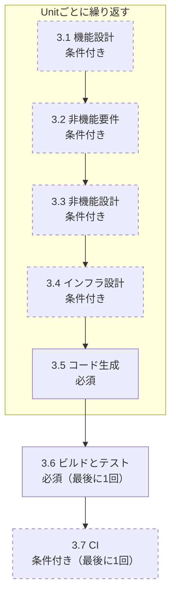
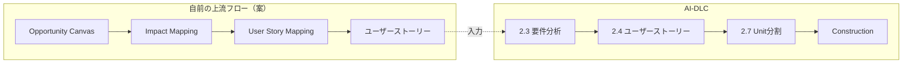
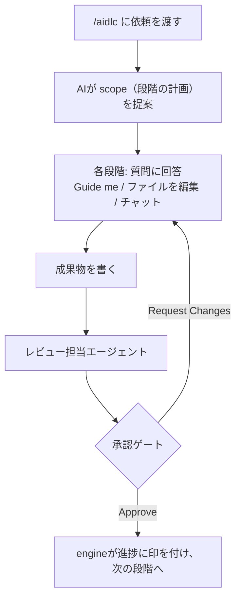

# AI-DLC入門

## 概要

AWSが提唱した、AIを開発の中心に置く方法論 AI-DLC（AI-Driven Development Life Cycle）を図で整理する。AIが質問・下書き・実装を担い、人間が各段階で承認する。成果物（md）が次の段階の記憶になる。

---

## 0. 前提: SDLCとは

**SDLC（Software Development Life Cycle、ソフトウェア開発ライフサイクル）**は、ソフトウェアを作って運用するまでの工程を、段階に分けて捉える考え方。



SDLCは工程の名前の集まりで、進め方の型は別にある。代表的な型は次の2つ。



| 進め方 | 特徴 |
|---|---|
| ウォーターフォール | 工程を順に進める。手戻りは大きいが、計画は立てやすい |
| アジャイル（Scrum など） | 週〜月の短い周期（スプリント）で、少しずつ作って確かめる |

AI-DLC は、このライフサイクルの中心にAIを置き直す方法論。工程の捉え方が変わる。

| SDLCの工程 | AI-DLC のフェーズ（筆者の対応づけ） |
|---|---|
| 要件定義、設計の入口 | Inception |
| 設計、実装、テスト | Construction |
| デプロイ、運用・保守 | Operations |

この対応は筆者の整理で、AWSの原典の記述ではない。

## 1. AI-DLCとは

従来のSDLCを拡張した方法論。AIを補助ツールではなく中心的な協力者として扱い、人間は質問への回答と成果物の承認で判断する側に回る。

| | 従来（Scrum など） | AI-DLC |
|---|---|---|
| 主役 | 人間。AIは補助 | AIが質問・下書き・実装を担い、人間が判断 |
| 反復の単位 | スプリント（週〜月） | Bolt（時間〜日。v2実装では計画上の納品の区切り） |
| 作業のまとまり | エピック | Unit of Work（DDDのサブドメインに近い） |
| チームの場 | プランニングなどの会議 | Mob Elaboration / Mob Construction（AIの提案をその場で検証） |

実装は、マークダウンのルールファイルとして公開されている（awslabs/aidlc-workflows、MIT-0）。Claude Code、Kiro、Codex CLI、Cursor、GitHub Copilot などで動く。

## 2. 全体像: 原典は3フェーズ、公式実装は5フェーズ



| 英語 | 直訳 | AI-DLCでの意味 |
|---|---|---|
| Initialization | 初期化 | 作業場の準備 |
| Ideation | 構想 | 構想の検証と承認（go / no-go） |
| Inception | 開始・発足 | 要件・ユーザーストーリー・Unit分割・納品計画を固める |
| Construction | 構築 | Unitごとに設計・実装・テスト |
| Operations | 運用 | デプロイと運用 |

- 日本語の解説記事は、訳さず英語のまま書くことが多い。
- 公式実装のドキュメントは5フェーズ・計33段階と記載している。

## 3. 人間はどこで関与するか

初期化を除くすべての段階の終わりに承認ゲートがある。



- Construction では「自動で続行」にもできる。ただし、計画の承認や失敗時の対応には人間が必要。
- 原典は、レビューの場を Inception では **Mob Elaboration**、Construction では **Mob Construction** と呼ぶ。チーム全員がAIの質問と提案をその場で検証する。
- フェーズの境目で、成果物の存在と、ユーザーストーリーと Unit の対応などの追跡可能性が自動検証される。

## 4. Inception: ユーザーストーリーが作られる場所



- 実線は必須、破線は条件付き。実行計画で省かれた段階には承認ゲートが出ない。
- 2.4 のユーザーストーリーは必須ラベルが付いていない。ユーザー向け機能のときの条件付き。
- ユーザーストーリーと Unit の対応は、2.7 の `unit-of-work-story-map.md` に残る。

## 5. 用語: Intent / Unit / Bolt



- **Unit**: 独立して実装できる単位（WHAT）。2.7 で分割する。DDDのサブドメインやScrumのエピックに近いと説明されることが多い。
- **Bolt**: 1つ以上の依存関係を持つ Unit を束ねた、計画上の納品の区切り。2.9 で計画する。実行順は Unit の依存グラフが決め、Bolt の計画は順序を置き換えない。
- **Intent**: 原典は「達成すべき高レベルの目的」、実装の用語集は「案件の記録単位」と定義している。

## 6. Construction: Unitごとに回す



- 3.1〜3.5 は Unit ごと、3.6 と 3.7 は全 Unit の後に1回実行する。
- 承認の出し方は、Unit 単位（unit-major）か、段階ごとに全 Unit をまとめて（stage-major）か、を選べる。

## 7. 成果物

### 必須の段階と成果物

「必須」は、選んだ scope がその段階を含むなら必ず実行する、という意味。

| 段階 | 成果物 |
|---|---|
| 0.1〜0.3 初期化 | 案件の記録ディレクトリ、`aidlc-state.md`、`audit/` |
| 1.1 意図の整理 | 課題、ステークホルダー、成功指標 |
| 1.4 スコープ定義 | スコープ文書、Intent backlog |
| 1.7 承認と引き継ぎ | initiative brief |
| 2.3 要件分析 | `requirements.md` |
| 2.7 Unit分割 | `unit-of-work.md`、`unit-of-work-dependency.md`、`unit-of-work-story-map.md` |
| 2.9 納品計画 | `bolt-plan.md`、`team-allocation.md`、`risk-and-sequencing-rationale.md`、`external-dependency-map.md` |
| 3.5 コード生成（Unitごと） | コード |
| 3.6 ビルドとテスト | テスト結果、品質レポート |

- `stories.md` と `personas.md` は必須ではない。
- フェーズの境目で「必須成果物の存在」が自動検証されるが、その必須リストの具体は確認できていない。上の表は必須の段階が出すものを並べただけで、検証対象と一致する保証はない。

### 条件付きの主な成果物

| 段階 | 成果物 |
|---|---|
| 1.3 実現性・制約 | RAIDログ（リスク・前提・課題・依存） |
| 2.4 ユーザーストーリー | `stories.md`、`personas.md` |
| 2.6 ドメイン設計 | `components.md`、`decisions.md`（ADR） |
| 2.8 契約設計 | `contract-summary.md` |
| 3.1 機能設計 | `entities.md`、`rules.md`、`functional-spec.md` |
| 4.x Operation | CD設定、ロールバック手順書、ダッシュボード、アラーム、SLO設定など |

各段階は、読むファイルと書くファイルを宣言していて、エンジンがそのパスを次の段階へ渡す。成果物がAIの次の段階の記憶になる、と読める（筆者の解釈）。

## 8. scope: 規模に応じて段階を省く

一機能追加に全段階を回す前提ではない。scope で段階を省ける。省かれた段階には承認ゲートも出ない。

| scope | Ideation | Operation |
|---|---|---|
| enterprise / feature | 全7段階を実行 | 実行する |
| mvp | 1.1、1.3、1.4、1.6 のみ | 実行しない |
| poc | 1.1 のみ | 実行しない |
| bugfix / refactor / infra など | 丸ごと省く | 種類による |

feature が Inception と Construction のどこを省くかは、確認したページでは分からなかった。実際に動かして確かめる必要がある。

## 9. 上流フローとの位置関係（筆者の案）

AI-DLC の Ideation と Inception は、PO・ディレクターとのやり取りからユーザーストーリーを作る上流に重なる。AI-DLC の手前に自前の上流フローを置き、その出力を入力にする構成も取れる。



- Ideation の成果物が 2.4 や 2.7 へ渡る明示的な対応は、確認したページには書かれていなかった。
- User Story Mapping に当たる名前の段階は確認できなかった。近いのは 2.4 の `stories.md` と、2.7 の `unit-of-work-story-map.md`。

## 10. 資料間で食い違う点

- フェーズ数: 原典・解説記事は3つ、公式実装のドキュメントは5つ。
- Intent の定義: 原典は「達成すべき高レベルの目的」、実装の用語集は「案件の記録単位」。
- Bolt: 原典は時間〜日単位の反復。v2 実装では計画上の納品の区切りで、並列実行のバッチとは別物。
- 段階数: 検索結果の要約は32、実装のドキュメントは33と記載している。
- DDD、BDD、TDD それぞれに向けたフレーバーがあると紹介する記事もあるが、一次資料では未確認。

## 11. v2（2.x）実装の仕組み

「v2」は、awslabs/aidlc-workflows の 2.x 系を指す。確認したページには、v1 と v2 の差分や移行手順の記載は無かった。2026-11-20 時点の安定版は 2.11.4（2026-11-13）。

### 5つの層

| 層 | 中身 |
|---|---|
| Rules | チームの記憶。`aidlc/spaces/<space>/memory/` に、組織・チーム・プロジェクトの md を置く |
| Agents | 14体。ドメイン専門11、レビュー担当2、適応的な構成役1 |
| Knowledge | 参照知識（`knowledge/`）。Word・Excel・PDF も読める（2.11.4） |
| Skills | 指揮役 `skills/aidlc/SKILL.md` と、33個の段階ファイル |
| Hooks | 監査、セッション、状態の同期、検証 |

- **conductor（指揮役）**: オーケストレーター用のスキル。段階を進行させる。
- **engine**: 承認後に進捗へ印を付け、次の段階へ導く実行部分。
- 状態は案件ごとの `aidlc-state.md` と `audit/` に残る。
- **Space**: チーム単位の入れ物。既定は `aidlc/spaces/default/`。

### 実行の流れ



- フェーズの境目に検証ゲートが3つある（Ideation → Inception、→ Construction、→ Operation）。
- Operation の結果は Ideation へフィードバックされる。
- Construction は Unit ごとに5段階、その後に2段階を1回実行する。

### scope（plan）ごとの段階数

| scope | 段階数 |
|---|---|
| classic | 14（v1 風の儀式で Inception と Construction を通す。暗黙の既定） |
| feature | 29 |
| express | 6 |
| poc | 4 |
| mvp | 19 |

- 全部で11種類のプロファイルがある。
- 2.7.0 で classic と express が足された。短い道筋として使える。

### 使い始め

```bash
# インストール
curl -fsSL https://github.com/awslabs/aidlc-workflows/releases/latest/download/install.sh | sh

# プロジェクトのルートで
aidlc config --harness claude
aidlc doctor
```

開始は、ハーネスの中で `/aidlc "<依頼>"` を実行する（Codex は `$aidlc`）。

| ハーネス | `--harness` |
|---|---|
| Claude Code | `claude` |
| Kiro（IDE と CLI v3） | `kiro` |
| Kiro CLI V2 | `kiro-v2` |
| Codex CLI | `codex` |
| Cursor | `cursor` |
| opencode | `opencode` |
| GitHub Copilot（CLI / VS Code） | `copilot` |

- Kiro CLI の「V2」は Kiro CLI のエンジン版で、AI-DLC のメジャー版とは別物。
- README は推奨モデルを Claude Opus 4.8 としている。
- 更新は `aidlc update` のあと、プロジェクトで `aidlc config --yes` と `aidlc doctor`。作業中の案件は引き継がれる。

### リリース

- 2.11.4（2026-11-13、安定版）: Kiro を `kiro` と `kiro-v2` に分割。スクリプトで `--harness kiro` を Kiro CLI V2 向けに使っていると壊れる。
- 2.11.3（2026-11-04）: Bun の更新（CVE対応）、opencode は 1.18.29 以上が必要。
- 2.7.0: classic と express を追加。Domain Design と Contract Design、既存の PRD・ビジョン文書を入力にする機能。
- 2.11.5 の preview 版が日次で出ている。安定版ではない。
- 2.0.0 のリリースノートは取得できず、日付と内容は未確認。

## 参考リンク

- [awslabs/aidlc-workflows（README）](https://github.com/awslabs/aidlc-workflows)
- [同: Getting Started](https://awslabs.github.io/aidlc-workflows/guide/01-getting-started/)
- [同: Architecture](https://awslabs.github.io/aidlc-workflows/reference/01-architecture/)
- [AWS DevOps Blog: AI-Driven Development Life Cycle（原典）](https://aws.amazon.com/blogs/devops/ai-driven-development-life-cycle)
- [awslabs/aidlc-workflows: Phases and Stages](https://awslabs.github.io/aidlc-workflows/guide/04-phases-and-stages/)
- [同: Glossary（Intent / Unit / Bolt の定義）](https://awslabs.github.io/aidlc-workflows/guide/glossary/)
- [同: Ideation Stage Reference](https://awslabs.github.io/aidlc-workflows/reference/04-stages/ideation/)
- [Accelerating software delivery with units of work in the AI-DLC](https://builder.aws.com/content/3HAB4twQ38WEKqLK7gfEIfOzHbc/accelerating-software-delivery-with-units-of-work-in-the-ai-dlc)
- [IBM: AI-DLC（日本語）](https://www.ibm.com/jp-ja/think/topics/ai-dlc)
- [一創: AI-DLC 解説（日本語）](https://www.issoh.co.jp/tech/details/9662/)
- [サーバーワークス: ai-dlc-workflows クイックスタート（日本語）](https://blog.serverworks.co.jp/ai-dlc-workflows-quickstart-guide)
