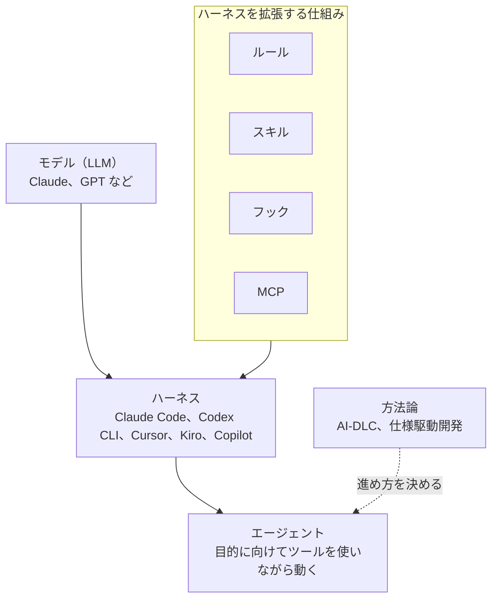
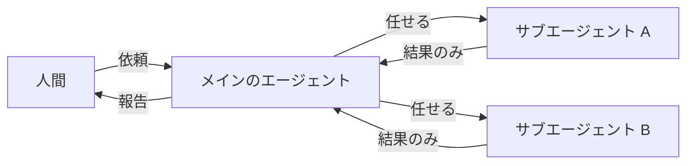
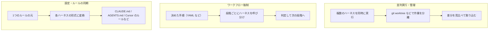

# AI用語集

## 概要

AIコーディングまわりで出てくる用語を、層ごとに整理する。モデル・ハーネス・エージェントの関係が分かると、Claude Code や AI-DLC の記事が読みやすくなる。

---

## 1. 全体の関係

- **モデル**は頭脳、**ハーネス**はそれを動かす外側。ルール・スキル・フック・MCP は、ハーネスに足す部品。
- **方法論**は、その上で「どう進めるか」を決める。AI-DLC は方法論で、サービスではない。

## 2. 基礎

| 用語 | 意味 |
|---|---|
| モデル（LLM） | 文章を読んで文章を出す、AIの本体。Claude、GPT など |
| プロンプト | モデルへの指示・入力 |
| トークン | モデルが文章を処理する単位。料金や長さの上限はトークンで数える |
| コンテキスト | モデルが一度に見ている情報の全体（指示、会話、読んだファイルなど） |
| コンテキストウィンドウ | コンテキストに入れられる量の上限 |

## 3. ハーネスとエージェント

| 用語 | 意味 |
|---|---|
| ハーネス | モデルを包み、ファイルの読み書き、コマンド実行、ツール呼び出しをさせる実行環境。例: Claude Code、Codex CLI、Cursor、Kiro、GitHub Copilot |
| ツール | モデルが呼び出せる機能。ファイルを読む、コマンドを実行する、検索するなど |
| エージェント | 目的に向けて、ツールを使いながら自分で行動を選んで進めるAI。1回答えて終わりではなく、結果を見て次の手を決める |
| サブエージェント | メインのエージェントから仕事を任された、別のエージェント。独立したコンテキストで動き、結果だけを返す |
| オーケストレーション | 複数の段階やエージェントを、順序や条件を決めて進行させること |

## 4. ハーネスを拡張する仕組み

| 用語 | 意味 | 関連記事 |
|---|---|---|
| ルール | いつも読ませる指示のファイル。例: `CLAUDE.md`、`AGENTS.md` | [Rules機能ガイド](claude-code/Claude_Code_Rules機能ガイド.md)、[CLAUDE.md vs AGENTS.md](ai-coding-agents/CLAUDE_md_vs_AGENTS_md.md) |
| スキル | 特定の仕事のための手順書。必要なときだけ読み込まれる（`SKILL.md`） | [SKILL.md フロントマター仕様](claude-code/Claude_Code_SKILL_md_フロントマター仕様.md) |
| フック | ツールの実行前後などのイベントで、自動的に動くスクリプト | [Hooks機能ガイド](claude-code/Claude_Code_Hooks機能ガイド.md) |
| MCP（Model Context Protocol） | AIに外部のツールやデータをつなぐための共通の取り決め | [MCPサーバー設定ガイド](claude-code/Claude_Code_MCPサーバー設定ガイド.md) |
| サブエージェント機能 | ハーネス側でサブエージェントを定義・呼び出す仕組み | [Sub-agents機能ガイド](claude-code/Claude_Code_Sub-agents機能ガイド.md) |

## 5. 方法論とチームでの進め方

| 用語 | 意味 |
|---|---|
| AI-DLC | AWSが提唱した、AIを開発の中心に置く方法論。ルールファイルの集まりで、サーバーは無い。詳細は [AI-DLC入門](ai/AI-DLC入門.md) |
| 仕様駆動開発 | 先に仕様を書き、AIが仕様から実装する進め方。[仕様駆動開発ツール](ai/仕様駆動開発ツール.md) |
| Mob（Mob Elaboration など） | チーム全員で、AIの提案をその場で検証する場。AI-DLC の用語 |
| Intent / Unit / Bolt | AI-DLC の用語。案件、実装単位、納品の区切り |

## 6. ハーネスを束ねるツール

複数のハーネスを扱うツールは、束ね方で3種類に分かれる。

| 種類 | 何をする | 例 |
|---|---|---|
| 並列実行・管理 | 複数のハーネスを同時に走らせ、作業を分離して、差分を見比べる | [Conductor](ai/Conductor.md)、[Claude Squad](ai/Claude_Squad.md)、[Sculptor](ai/Sculptor.md)、[Vibe Kanban](ai/Vibe_Kanban.md) |
| ワークフロー強制 | 決めた手順どおりに、複数のハーネスを呼び分けて実行させる | [TAKT](ai/TAKT_AIエージェントオーケストレータ.md)。AI-DLC の conductor も、1つのハーネスの中で近い役割をする |
| 設定・ルールの同期 | 1つのルールを、各ハーネスの形式に配る | [Ruler](ai/Ruler.md)、[rulesync](ai/rulesync.md)、[AgentsMesh](ai/AgentsMesh.md) |

- 並列実行は、worktree で分けても同じマシンと環境を共有する。インストールやマイグレーションの暴走は実ファイルに及ぶ。
- 対応ハーネスや保守状況は、ツールと時期で変わる。使う前に各ツールの最新ドキュメントで確認する。
- `CLAUDE.md` から `AGENTS.md` を読み込んで共有する運用は、ルール同期を手作りしている形。

## 7. 混同しやすい点

- **ハーネスとモデル**: Claude Code はハーネスで、Claude はモデル。同じハーネスでモデルを替えられるものもある。
- **エージェントとサブエージェント**: サブエージェントも、エージェントの一種。違いは、誰から任されたかと、独立したコンテキストを持つこと。
- **スキルとルール**: ルールは常に読む。スキルは必要なときだけ読む。
- **AI-DLC とハーネス**: AI-DLC はハーネスの上で動く方法論。ハーネスごとの形式でファイルを配る。
- 用語の定義は、ツールや資料によって揺れる。ここでの説明は、一般的な使われ方に基づく整理。

## 参考リンク

- [Claude Code ドキュメント](https://docs.claude.com/en/docs/claude-code/overview)
- [Model Context Protocol](https://modelcontextprotocol.io/)
- [AI-DLC入門](ai/AI-DLC入門.md)
- [Best Multi-Agent Coding Tools for Claude Code and Codex Users (2026)](https://nimbalyst-website.pages.dev/blog/best-multi-agent-coding-tools-2026/)
- [The best AI agent orchestration tools for coding in 2026](https://crystl.dev/blog/best-ai-agent-orchestration-tools/)
- [One Rules Source for Every Agent: AGENTS.md, Ruler and rulesync](https://developertoolkit.ai/en/ecosystem/frameworks/rules-sync/)
