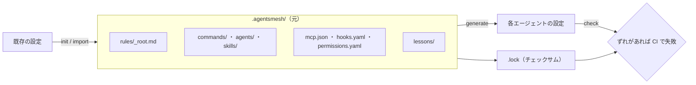
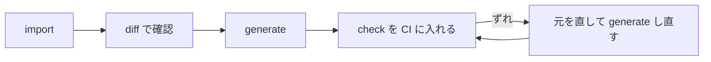

# AgentsMesh

## 概要

`.agentsmesh/` を唯一の元として、各コーディングエージェントの設定を生成する CLI。既存設定の取り込み（import）、lockfile による差分検出、ファイル間リンクの書き換えなど、設計は3つの同期ツールで最も作り込まれている。2026-03 に始まった若いプロジェクト。分類は「設定・ルールの同期」（[AI用語集](ai/AI用語集.md) の6章）。

---

## 1. 基本情報（2026-11-20 時点）

| 項目 | 内容 |
|---|---|
| 開発 | sampleXbro。メンテナは1人 |
| ライセンス | MIT |
| 対応エージェント | 33。CLI 16（Claude Code、Codex CLI、Gemini CLI、OpenCode など）、IDE 14（Cursor、Copilot、Kiro、Windsurf など）、クラウド 3。プラグインで追加できる |
| 同期できるもの | ルール、コマンド、サブエージェント、スキル、MCP、フック、ignore、権限、lessons（エージェント間で共有する記憶） |
| 必要なもの | Node.js 20.19 以上 |
| 最新版 | 0.43.1（2026-11-05）。すべて 0.x |

## 2. 仕組み



- 設定は `agentsmesh.yaml`。個人ごとの上書きは `agentsmesh.local.yaml`（これだけ gitignore）。
- エージェントに対応する場所が無い内容は、捨てずに埋め込み、取り込み直せる情報を残す。
- ファイル間のリンクは、出力先ごとに書き換えられる。

## 3. 使い始め

```bash
npm i -g agentsmesh     # 別名 amsh
# Homebrew
brew install samplexbro/agentsmesh/agentsmesh

agentsmesh init         # 既存設定を検出して取り込むウィザード（--yes で非対話）
agentsmesh diff         # 生成される差分を確認
agentsmesh generate     # 各エージェントの設定を書き出す
agentsmesh check        # 元と生成物のずれを確認（CI 用）
```

README の推奨手順は「import → diff → generate → check」。ほかのコマンド: `convert`、`lint`、`watch`、`merge`（git の衝突後に lock を作り直す）、`matrix`（エージェントごとの対応表）、`lessons`、`mcp`。

## 4. 活用できること（筆者の案）

| 使い方 | 内容 |
|---|---|
| 既存設定を壊さずに導入 | `init` で今の設定を取り込み、`diff` で確認してから生成する |
| 生成物も含めて git で管理 | lockfile のように生成物もコミットし、`check` で手での直接編集を CI で検出する |
| エージェント間で学びを共有 | lessons で、あるエージェントが得た注意点を、別のエージェントにも渡す |
| 対応状況の確認 | `matrix` で、どのエージェントで何が使えるかを一覧する |



## 5. 注意点

- 始まって約8か月、メンテナは1人。1.0 の安定の約束は無い。
- 対応エージェント数は rulesync より少ない（README 自身が認めている）。
- README の比較表は、作者自身が書いたもの。
- エージェントによって対応の度合い（そのまま、埋め込み、部分的）が違う。
- 「元に戻す」コマンドは無い。古い生成物は `generate` のときに片付けられる。
- `init` は既定で対話式。非対話で既存設定が見つかると止まる。

## 参考リンク

- [sampleXbro/agentsmesh（GitHub）](https://github.com/sampleXbro/agentsmesh)
- [AgentsMesh ドキュメント](https://samplexbro.github.io/agentsmesh/)
- [agentsmesh（npm）](https://www.npmjs.com/package/agentsmesh)
