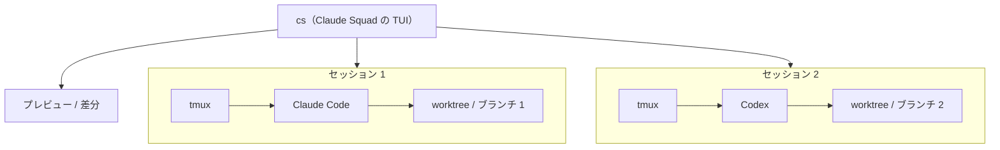
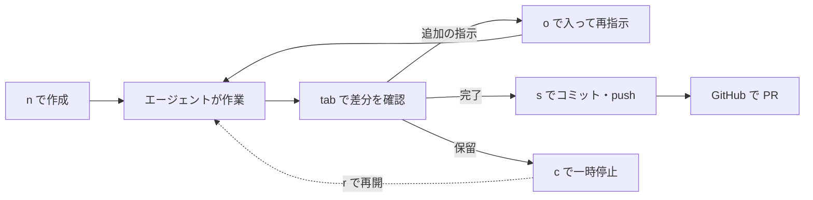

# Claude Squad

## 概要

複数のターミナル型AIエージェント（Claude Code、Codex、Gemini、Aider など）を、ターミナルの1画面で管理する OSS。各エージェントは tmux のセッションと、分離した git worktree の中で動く。分類は「並列実行・管理」（[AI用語集](ai/AI用語集.md) の6章）。

---

## 1. 基本情報（2026-11-20 時点）

| 項目 | 内容 |
|---|---|
| 開発 | GitHub の smtg-ai |
| ライセンス | AGPL-3.0。無料 |
| 対応OS | README に記載なし。tmux と Go 製バイナリなので macOS と Linux、Windows は WSL 経由と推測（未確認） |
| 対応エージェント | Claude Code（既定）、Codex、Gemini、Aider、OpenCode、Amp。`-p` で任意のプログラムを指定できる |
| 必要なもの | tmux、gh（GitHub CLI）、git、使うエージェントの CLI |
| 最新版 | v1.0.20（2026-08-20）。リリースは1〜2か月おき。リポジトリの更新は11月も続いている |

## 2. 仕組み



- 1つの画面に、セッションの一覧、プレビュー、差分が並ぶ。
- エージェントはバックグラウンドで動き続ける。

## 3. 使い始め

```bash
# Homebrew
brew install claude-squad
ln -s "$(brew --prefix)/bin/claude-squad" "$(brew --prefix)/bin/cs"

# またはスクリプト（~/.local/bin に cs を置く）
curl -fsSL https://raw.githubusercontent.com/smtg-ai/claude-squad/main/install.sh | bash
```

git リポジトリの中で `cs` を実行する。

| キー | 動作 |
|---|---|
| `n` / `N` | 新しいセッション / プロンプト付きで新しいセッション |
| `↑` `k` / `↓` `j` | 移動 |
| `↵` `o` / `ctrl-q` | セッションに入る（再指示） / 抜ける |
| `tab` | プレビューと差分の切り替え（`shift-↑↓` で差分をスクロール） |
| `s` | コミットして push |
| `c` / `r` | ブランチをチェックアウトして一時停止 / 再開 |
| `D` / `?` / `q` | セッション削除 / ヘルプ / 終了 |

- オプション: `-y`（自動承認、実験的）、`-p`（起動するプログラム）
- 設定は `~/.claude-squad/config.json`。場所は `cs debug` で確認できる。

## 4. 作業の流れ



## 5. 活用できること（筆者の案）

| 使い方 | 内容 |
|---|---|
| ターミナルから離れずに並列作業 | エディタを開かず、tmux の中で複数のタスクを同時に進める |
| 長い作業をバックグラウンドへ | テスト修正のような時間のかかる作業を任せ、終わったら差分だけ見る |
| エージェントの使い分け | 調査は Claude Code、別の実装案は Codex、と `-p` やプロファイルで切り替える |
| SSH 先のサーバーで使う | tmux ベースなので、リモートの開発環境でも動かせる（推測） |

## 6. 注意点

- `-y`（自動承認）は実験的。全部の操作を自動で通すので、使う範囲を絞る。
- 「timed out waiting for tmux session」のエラーは、エージェント CLI の更新で直る、と README に記載。
- 認証は各エージェント CLI のログインをそのまま使う。README が触れているのは、Codex 用の `OPENAI_API_KEY` だけ。
- AGPL-3.0 は、改変して配布したりサービスとして提供したりする場合に影響する。社内で使うだけなら通常は問題になりにくい。

## 参考リンク

- [smtg-ai/claude-squad（GitHub）](https://github.com/smtg-ai/claude-squad)
- [Releases](https://github.com/smtg-ai/claude-squad/releases)
