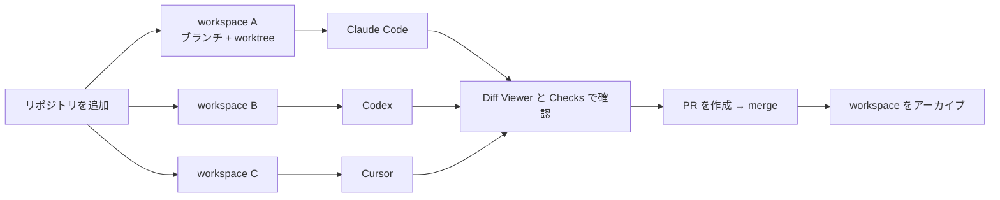
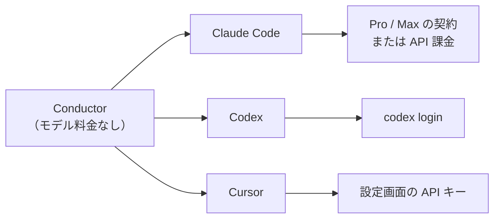
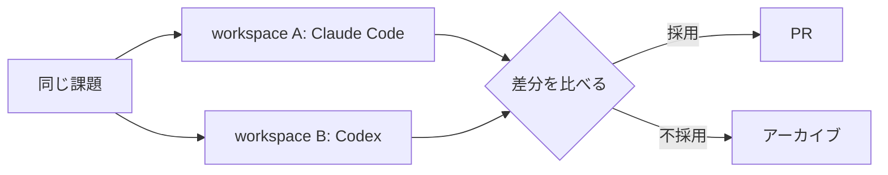

# Conductor

## 概要

複数のコーディングエージェント（Claude Code、Codex、Cursor、OpenCode）を並列で動かす macOS アプリ。タスクごとに workspace（ブランチ、ファイル、ターミナル、差分）を分け、差分を確認して PR を出す。分類は「並列実行・管理」（[AI用語集](ai/AI用語集.md) の6章）。

---

## 1. 基本情報（2026-11-20 時点）

| 項目 | 内容 |
|---|---|
| 開発 | 公式サイトに記載なし。iOS アプリの掲載情報では Melty, Inc.（未確認） |
| ライセンス・料金 | クローズドソース。**現在は無料**。共同作業の機能は今後有料になると FAQ に記載。有料プランの金額は資料ごとに食い違い、未確認 |
| 対応OS | macOS のみ。Windows と Linux は未対応 |
| 対応エージェント | Claude Code（アプリに同梱）、Codex、Cursor、OpenCode |
| 必要なもの | GitHub の認証（`gh auth status` で確認）、エージェントを1つ以上 |
| 最新版 | 0.96.0（2026-11-18）。ほぼ毎日リリースされている。まだ 0.x |

## 2. 仕組み

- workspace は git worktree で分離される。
- 機能: 差分ビューア、Checks、チェックポイント、TODO、スクリプト、MCP、スラッシュコマンド、Conductor 自身の API と MCP サーバー、Cloud と複数人での利用。

## 3. 使い始め

1. 公式サイトからダウンロードし、Applications に入れて開く。起動時に GitHub 認証などの不足が案内される。
2. リポジトリを追加する（Open project、Open GitHub project、Quick start）。
3. workspace を作る。追加は Cmd+Shift+N。
4. 必要なら setup スクリプトと実行アクションを設定する。
5. エージェントとチャットして作業させる。
6. Diff Viewer（Cmd+Shift+D）と Checks で確認し、PR を作って merge、workspace をアーカイブする。

ショートカット一覧は、アプリ内の Cmd+/ で開く。

## 4. 認証と課金

- 手元のマシンにある認証情報をそのまま使う。Conductor がモデル料金を取るわけではない。
- **注意**: `ANTHROPIC_API_KEY` が Conductor か起動したシェルに設定されていると、Claude Code は契約ではなく API キーを使い、API 料金が発生しうる。

## 5. 活用できること（筆者の案）

| 使い方 | 内容 |
|---|---|
| 同じ課題を複数のエージェントで解かせる | Claude Code と Codex に同じ依頼を出し、差分を見比べて良いほうを採る |
| 独立したタスクの並行処理 | バグ修正、テスト追加、ドキュメント更新を別々の workspace で同時に進める |
| レビュー待ちの間に次の作業 | 1つ目の PR のレビュー中に、2つ目の workspace で次のタスクを進める |
| 試行錯誤の使い捨て | 方針の違う実装を workspace ごとに試し、不要なものはアーカイブする |

## 6. 注意点

- エージェントは**サンドボックスなし**で、自分のユーザー権限で動く。FAQ は、より安全にしたい場合に VM や別マシンを勧めている。
- データは `~/Library/Application Support/com.conductor.app` と `~/conductor` に保存される。
- テレメトリなどのプライバシーの詳細は未確認。使う前に公式のプライバシーのページを読む。
- 0.x で変更が速い。

## 参考リンク

- [Conductor（公式サイト）](https://www.conductor.build)
- [ドキュメント](https://www.conductor.build/docs/)
- [インストール](https://www.conductor.build/docs/installation)
- [最初の workspace](https://www.conductor.build/docs/first-workspace)
- [Claude Code の認証と課金](https://www.conductor.build/docs/reference/harnesses/claude-code)
- [FAQ](https://www.conductor.build/docs/faq)
- [Changelog](https://www.conductor.build/changelog)
- [プライバシー](https://www.conductor.build/docs/reference/privacy)
