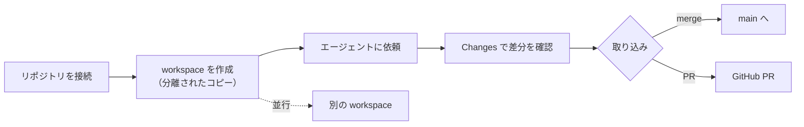
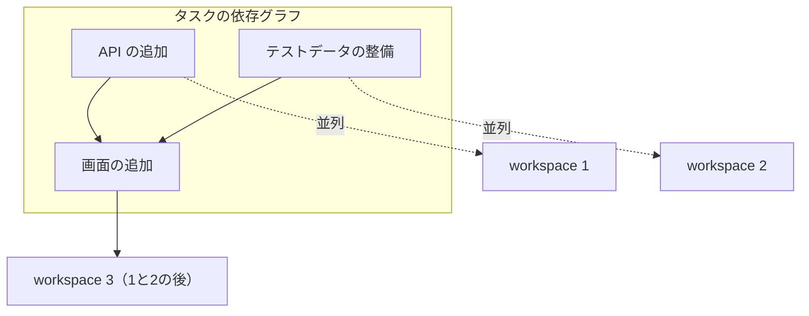

# Sculptor

## 概要

Imbue が開発する、複数のコーディングエージェントを並列で動かすデスクトップアプリ。作業ごとに分離した workspace を作り、差分を確認して main へ取り込むか PR を出す。分類は「並列実行・管理」（[AI用語集](ai/AI用語集.md) の6章）。

---

## 1. 基本情報（2026-11-20 時点）

| 項目 | 内容 |
|---|---|
| 開発 | Imbue |
| ライセンス | MIT。無料でダウンロードできる（料金ページは見当たらない） |
| 対応OS | Mac（Apple Silicon）、Linux x86、Linux ARM64。Intel Mac と Windows は未対応（対応予定と告知） |
| 対応エージェント | Claude Code、Pi。ほかのターミナル型エージェントも実行・管理できる。Codex 対応はマーケティングページのみの記載 |
| 必要なもの | Claude CLI と git。Docker は既定では不要 |
| 最新版 | v0.50.0（2026-11-16）。開発は活発 |
| 位置づけ | README は「実験的な研究プレビュー」と明記。不具合と急な変更がありうる |

## 2. 仕組み

- ドキュメントは workspace を「リポジトリの分離された worktree」と説明している。
- 公式サイトは「各エージェントが自分のコンテナで動く」と書いており、ドキュメントと食い違う。コンテナ（Docker）は、実験的なバックエンドとしてのみ記載がある。既定は worktree と読める。

## 3. 使い始め

1. README のリンクからダウンロードする。
   - Apple Silicon: https://tryimbue.link/sculptor-for-apple-silicon
   - Linux: https://tryimbue.link/sculptor-for-linux
   - Linux ARM64: https://tryimbue.link/sculptor-for-linux-arm64
2. アプリを開き、初回ウィザードで名前とメールを入力する。Claude CLI と git の有無が確認される。
3. リポジトリを追加し、workspace を作ってエージェントに依頼する。
4. Changes で差分を確認し、コミットして PR を出す。
5. 並行作業は、別の workspace を開くか、同じ workspace に2体目のエージェントを足す。

## 4. 主な機能

- 分離された workspace、内蔵ターミナル、差分のライブ確認、PR 作成と状態の追跡
- チャットで計画・effort・モデルを指定、メッセージのキュー、タスクの依存グラフ
- コマンドパレット（Cmd+K）、同梱スキル（例: `/sculptor-workflow:fix-bug`）
- アプリが落ちても、エージェントのプロセスは残る

## 5. 活用できること（筆者の案）

| 使い方 | 内容 |
|---|---|
| 依存のあるタスクを並べて進める | タスクの依存グラフで、先にやる作業と後の作業を分けて並列化する |
| 1つの workspace に2体のエージェント | 実装役と確認役のように、同じコードに2体を当てる |
| 定番作業をスキルで流す | 同梱スキル（例: バグ修正の流れ）で、手順を毎回そろえる |
| GUI で差分と PR を管理 | ターミナルが苦手なメンバーでも、差分確認と PR 作成を画面で完結できる |

## 6. 注意点

- Claude はサンドボックス内で、ツールの許可を自動承認して動く。
- 認証と課金の説明はドキュメントに無い。自分の Claude のログインや API キーを使う形と推測されるが、未確認。
- 外部からの貢献は、あまり受け付けていない。
- 試すなら、まず小さなリポジトリで、差分確認とPR作成の流れを1回通す。

## 参考リンク

- [imbue-ai/sculptor（GitHub）](https://github.com/imbue-ai/sculptor)
- [Sculptor（公式サイト）](https://imbue.com/sculptor/)
- [Getting Started](https://github.com/imbue-ai/sculptor/blob/main/docs/help/getting_started.md)
- [実験的なコンテナバックエンド](https://github.com/imbue-ai/sculptor/blob/main/docs/help/experimental/container_backend.md)
