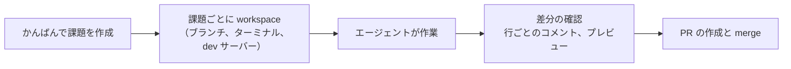
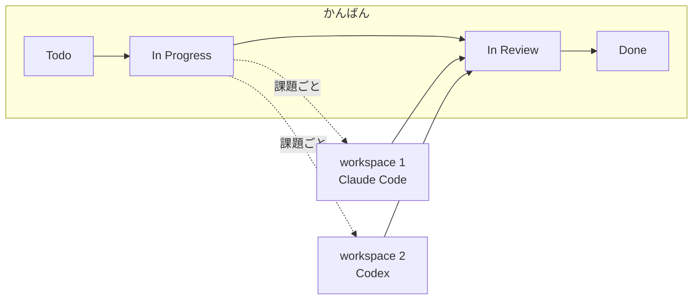

# Vibe Kanban

## 概要

かんばんで作業を計画し、作業ごとに分離した workspace でコーディングエージェントを動かすツール。開発元の Bloop は 2026-04-10 に事業終了を発表したが、OSS としてコミュニティで保守が続いている。分類は「並列実行・管理」（[AI用語集](ai/AI用語集.md) の6章）。

---

## 1. 基本情報（2026-11-20 時点）

| 項目 | 内容 |
|---|---|
| 開発 | Bloop（BloopAI）。現在はコミュニティ保守 |
| ライセンス | Apache-2.0。無料。有料のクラウド版は終了 |
| 対応エージェント | Claude Code、Codex、Gemini CLI、GitHub Copilot、Amp、Cursor、OpenCode、Droid、CCR、Qwen Code。ACP レジストリのエージェントも |
| 必要なもの | Node.js 20 以上と、ログイン済みのエージェント CLI |
| 対応OS | npm の CLI は複数OS向け。OS の一覧は未確認 |
| 最新版 | v0.1.46（2026-11-15）。リポジトリはアーカイブされていない |

## 2. 事業終了の経緯

- 2026-04-10: Bloop が終了を発表。README の冒頭も「sunsetting」になっている。
- リモートのサービスは30日間維持したあと、完全にローカルで動く構成へ移行した。
- 削除された機能: クラウドのかんばん課題、コメント、プロジェクト、組織。
- サブスクリプションは終了し、直近30日分は返金。データのエクスポート機能が追加された。
- ローカルの workspace は引き続き動く。
- 競合が書いた記事1件だけが、「v0.1.44 以降、プロジェクトの画面が廃止された」と書いている。未確認で、かんばんの流れが使えるかは試して確かめる必要がある。

## 3. 仕組み



- workspace は、ブランチ、ターミナル、dev サーバーを持つ。git worktree を使っていると推測されるが、未確認。

## 4. 使い始め

```bash
npx vibe-kanban
```

1. 上のコマンドで、ローカルに Web 画面が開く。
2. かんばんに課題を作り、エージェント用の workspace を作る。
3. 差分とコメントを確認し、PR を作って merge する。

## 5. 活用できること（筆者の案）

| 使い方 | 内容 |
|---|---|
| 課題の一覧から順にエージェントへ渡す | かんばんの課題1枚ごとに workspace を作り、並べて処理する |
| エージェントの比較 | 対応エージェントが多いので、同じ課題を別々のエージェントで試せる |
| 画面を見ながらのレビュー | workspace ごとの dev サーバーで、変更後の画面をプレビューしてから merge する |
| 手軽な試用 | `npx` 1行で起動できるので、並列実行の感触を掴む入門に向く |



かんばんの列名は説明用の例で、実際の画面の列名は未確認。

## 6. 注意点

- 開発元が無くなったため、長期の保守は不透明。
- クラウドとチーム共同作業の機能は削除済み。
- 認証と課金は、各エージェント CLI のログインや API キーをそのまま使う。Vibe Kanban 側の課金は無い。
- 試すなら `npx` で手軽に動かせる。業務の常用は、保守状況を見てから判断する。

## 参考リンク

- [BloopAI/vibe-kanban（GitHub）](https://github.com/BloopAI/vibe-kanban)
- [Vibe Kanban の終了告知](https://www.vibekanban.com/blog/shutdown)
- [終了に関するページ](https://www.vibekanban.com/shutdown)
