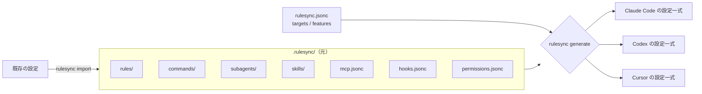
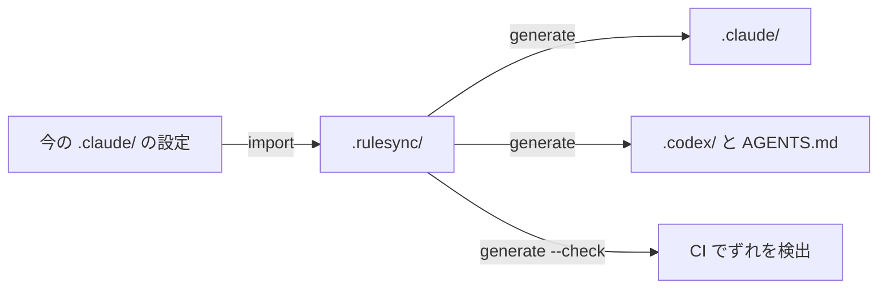

# rulesync

## 概要

`.rulesync/` の共通ファイルから、各コーディングエージェントの設定を生成する CLI。ルールだけでなく、コマンド、サブエージェント、スキル、MCP、フック、権限まで扱い、対応範囲は3つの同期ツールで最も広い。メジャー版の更新が非常に速いので、バージョン固定が前提。分類は「設定・ルールの同期」（[AI用語集](ai/AI用語集.md) の6章）。

---

## 1. 基本情報（2026-11-20 時点）

| 項目 | 内容 |
|---|---|
| 開発 | dyoshikawa。メンテナは1人 |
| ライセンス | MIT |
| 対応エージェント | 約50（件数は他ツールの README による、未確認）。Claude Code、Codex CLI、Copilot、Cursor、Kiro、OpenCode、Zed など。`AGENTS.md` などの共通規格にも出力できる |
| 同期できるもの | ルール、コマンド、サブエージェント、スキル、MCP、フック、権限、ignore（非推奨、権限へ移行）、checks。エージェントごとに対応範囲は異なる |
| 最新版 | 43.10.1（2026-11-20）。2026-07 から 11 の5か月で、メジャー版が10から43まで上がった |

## 2. 仕組み



- `rulesync.jsonc` の `targets`（対象エージェント）と `features`（同期する種類）で、出力を絞る。
- `import` で、既存の設定を `.rulesync/` に取り込める。`convert` で、エージェントからエージェントへ直接変換もできる。

## 3. 使い始め

```bash
npm i -g rulesync        # 本番ではバージョンを固定: npm i -D rulesync@x.y.z
# Homebrew の場合（引数2つの tap が必要）
brew tap dyoshikawa/rulesync https://github.com/dyoshikawa/rulesync && brew install rulesync

rulesync init                                  # 既存ファイルは上書きしない
rulesync import --targets claudecode           # 既存の Claude Code 設定を取り込む
rulesync generate --targets "*" --features "*" --dry-run   # 出力を確認
rulesync generate --targets "*" --features "*"
rulesync gitignore                             # 生成物を .gitignore に追加
```

ほかのコマンド: `convert --from cursor --to claudecode`、`fetch owner/repo`、`doctor`、`release-notes`、`update`。`generate` のオプション: `--check`（CI 用の差分検出）、`--delete`（不要になった生成物を削除）、`--watch`。

## 4. 活用できること（筆者の案）

| 使い方 | 内容 |
|---|---|
| ルール以外もまとめて配る | スキル、サブエージェント、MCP、フックを、Claude Code と Codex の両方にそろえる |
| 既存設定からの移行 | 今の Claude Code の設定を `import` し、そこから Codex 用を生成する |
| CI で差分を検出 | `generate --check` で、元と生成物のずれを CI で落とす |
| 他リポジトリのルールを取り込む | `fetch` で、チームの共通ルールを別リポジトリから持ってくる |



## 5. 注意点

- **メジャー版がほぼ毎日上がる**。数日で4つ上がった時期もある。`npx rulesync` のままだと、CI の実行ごとに出力が変わりうる。バージョンを固定し、上げる前に `rulesync release-notes` を読む。
- 「元に戻す」コマンドは無い。近いのは `generate --delete` と `--retire-targets`。
- ignore は非推奨で、権限（permissions）への移行が勧められている。
- 一部の対応先は非推奨・終了予定（Roo、Continue、Rovo Dev など）。
- dotfiles のように symlink で設定を共有している場合、生成ファイルが symlink を上書きするかは未確認。空のリポジトリで `--dry-run` から試す。

## 参考リンク

- [dyoshikawa/rulesync（GitHub）](https://github.com/dyoshikawa/rulesync)
- [rulesync ドキュメント](https://rulesync.dyoshikawa.com)
- [CLI コマンド一覧](https://rulesync.dyoshikawa.com/reference/cli-commands)
- [rulesync（npm）](https://www.npmjs.com/package/rulesync)
