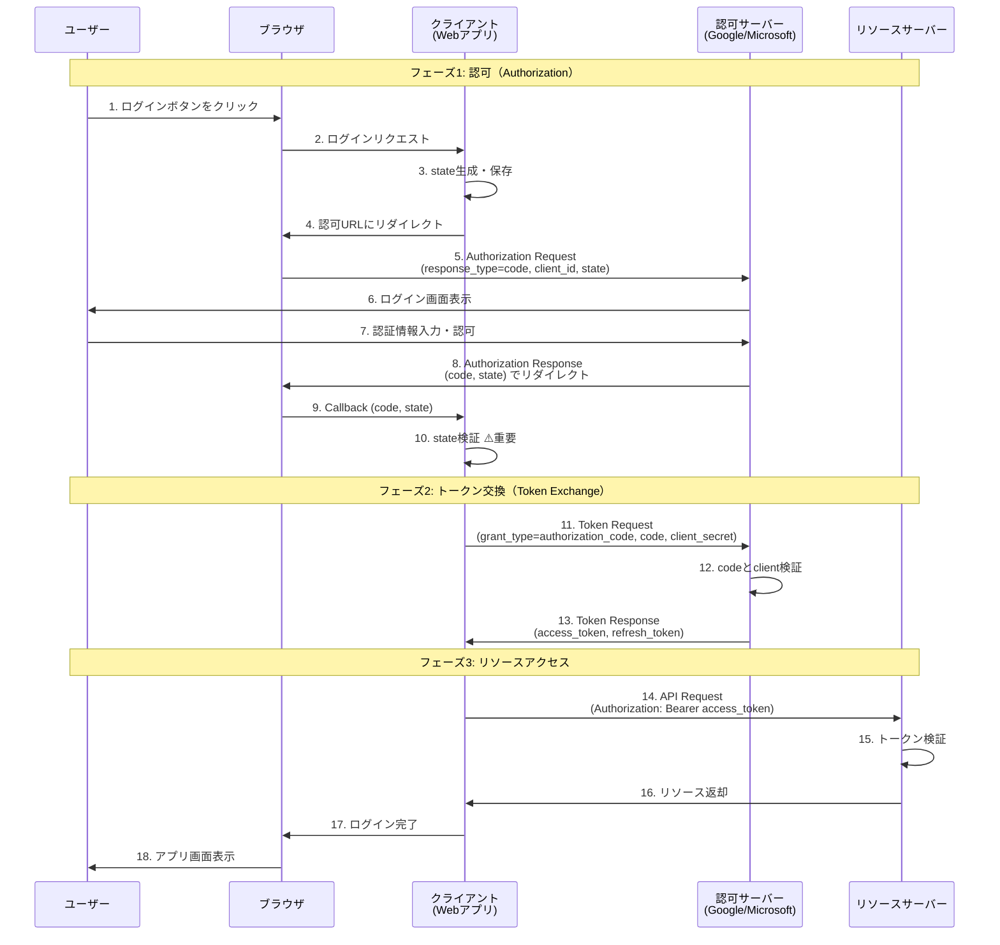

# OAuth 2.0 Authorization Code Flow

## 概要

OAuth 2.0 Authorization Code Flowは、認可コードを使用してアクセストークンを取得する認証フローです。

- **対象**: 機密クライアント（Confidential Client）およびパブリッククライアント（Public Client）
- **用途**: WebアプリケーションでのOAuth認証
- **特徴**: リダイレクトベースのフロー、認可コードとアクセストークンの分離

---

## 目次

1. [フロー全体像](#フロー全体像)
2. [詳細ステップ](#詳細ステップ)
3. [stateパラメータとCSRF対策](#stateパラメータとcsrf対策)
4. [PKCE拡張](#pkce拡張)
5. [セキュリティ考慮事項](#セキュリティ考慮事項)
6. [実装のベストプラクティス](#実装のベストプラクティス)

---

## フロー全体像

### シーケンス図（詳細版）



### 簡略版（RFC 6749準拠）

```
     +--------+                               +---------------+
     |        |--(A)- Authorization Request ->|   Resource    |
     |        |                               |     Owner     |
     |        |<-(B)-- Authorization Grant ---|               |
     |        |                               +---------------+
     |        |
     |        |                               +---------------+
     |        |--(C)-- Authorization Grant -->| Authorization |
     | Client |                               |     Server    |
     |        |<-(D)----- Access Token -------|               |
     |        |                               +---------------+
     |        |
     |        |                               +---------------+
     |        |--(E)----- Access Token ------>|    Resource   |
     |        |                               |     Server    |
     |        |<-(F)--- Protected Resource ---|               |
     +--------+                               +---------------+
```

---

## 詳細ステップ

### Step 1-2: Authorization Request（認可リクエスト）

クライアントがユーザーを認可サーバーにリダイレクトします。

**エンドポイント**: Authorization Endpoint
- 例: Google の場合 `https://accounts.google.com/o/oauth2/v2/auth`
- 例: Microsoft の場合 `https://login.microsoftonline.com/{tenant}/oauth2/v2.0/authorize`

**必須パラメータ**:
- `response_type`: `code` を指定（REQUIRED）
- `client_id`: クライアントの一意な識別子（REQUIRED）

**オプションパラメータ**:
- `redirect_uri`: 認可後のリダイレクト先URL（OPTIONAL、ただし推奨）
- `scope`: アクセス要求のスコープ（OPTIONAL）
- `state`: CSRF対策用のランダムな値（RECOMMENDED、セキュリティ上必須）

**リクエスト例**:
```
GET /authorize?response_type=code
    &client_id=s6BhdRkqt3
    &redirect_uri=https://client.example.com/callback
    &scope=openid%20profile%20email
    &state=xyz
    Host: server.example.com
```

### Step 3: Authorization Response（認可レスポンス）

ユーザーが認可を承認すると、認可サーバーがクライアントにリダイレクトします。

**リダイレクト先**: `redirect_uri`に指定したURL

**レスポンスパラメータ**:
- `code`: 認可コード（REQUIRED）
- `state`: リクエスト時と同じstate値（REQUIRED if sent in request）

**レスポンス例**:
```
HTTP/1.1 302 Found
Location: https://client.example.com/callback?code=SplxlOBeZQQYbYS6WxSbIA&state=xyz
```

**重要**: `state`パラメータは、リクエスト時に送信したものと完全一致する必要があります。

### Step 4: Token Request（トークンリクエスト）

クライアントが認可コードをアクセストークンに交換します。

**エンドポイント**: Token Endpoint
- 例: Google の場合 `https://oauth2.googleapis.com/token`
- 例: Microsoft の場合 `https://login.microsoftonline.com/{tenant}/oauth2/v2.0/token`

**必須パラメータ**:
- `grant_type`: `authorization_code` を指定（REQUIRED）
- `code`: Step 3で取得した認可コード（REQUIRED）
- `redirect_uri`: Step 2で指定したものと同じURI（REQUIRED if included in authorization request）
- `client_id`: クライアント識別子（REQUIRED if not authenticating）

**リクエスト例**:
```
POST /token HTTP/1.1
Host: server.example.com
Content-Type: application/x-www-form-urlencoded

grant_type=authorization_code
&code=SplxlOBeZQQYbYS6WxSbIA
&redirect_uri=https://client.example.com/callback
&client_id=s6BhdRkqt3
&client_secret=gX1fBat3bV
```

### Step 5: Token Response（トークンレスポンス）

認可サーバーがアクセストークンを発行します。

**レスポンスパラメータ**:
- `access_token`: 発行されたアクセストークン（REQUIRED）
- `token_type`: トークンタイプ（通常は`Bearer`）（REQUIRED）
- `expires_in`: トークンの有効期限（秒単位）（RECOMMENDED）
- `refresh_token`: リフレッシュトークン（OPTIONAL）
- `scope`: 認可されたスコープ（OPTIONAL）

**レスポンス例**:
```json
{
  "access_token": "2YotnFZFEjr1zCsicMWpAA",
  "token_type": "Bearer",
  "expires_in": 3600,
  "refresh_token": "tGzv3JOkF0XG5Qx2TlKWIA",
  "scope": "openid profile email"
}
```

---

## stateパラメータとCSRF対策

### stateパラメータの役割

`state`パラメータは**CSRF（Cross-Site Request Forgery）攻撃を防ぐため**に使用されます。

### CSRF攻撃のシナリオ

1. 攻撃者が正規の認可フローを開始し、認可コードを取得
2. 攻撃者がユーザーに罠URLを送信（例: `https://victim.app/callback?code=ATTACKER_CODE`）
3. ユーザーが罠URLをクリック
4. **stateパラメータの検証がない場合**、攻撃者のアカウントでログインしてしまう

### state検証の実装方法

#### 1. Authorization Request時

1. **ランダムなstate値を生成**（UUIDやセキュアランダム推奨）
   - 例: `3d89a5ff-0007-4f96-b267-6dbc53f84032`

2. **stateをサーバー側のセッションに保存**
   - Cookie（httpOnly, secure）
   - Redis
   - データベース
   - インメモリセッション

3. **認可URLにstateパラメータを含める**
   - `https://provider.com/authorize?client_id=xxx&state=3d89a5ff-0007-4f96-b267-6dbc53f84032&...`

#### 2. Authorization Response時（Callback）

1. **URLパラメータからstateを取得**
   - 例: `?code=xxx&state=3d89a5ff-0007-4f96-b267-6dbc53f84032`

2. **セッションから保存したstateを取得**

3. **2つのstateを比較検証**
   - 一致 → 正常フロー継続
   - 不一致 → CSRF攻撃の可能性、エラー返却

4. **検証成功後、認可コードを処理**

### 重要なポイント

1. **stateは必ずランダムな値を使用**（UUID、セキュアランダムなど）
2. **stateは1回限りの使用**（使用後は無効化）
3. **stateはサーバー側で保存・検証**（クライアント側だけでは不十分）
4. **state検証は認可コード処理の前に実施**

---

## PKCE拡張

**PKCE（Proof Key for Code Exchange）**は、OAuth 2.1で**必須**とされるセキュリティ拡張です。

### PKCEの目的

認可コードの傍受攻撃を防ぐため、クライアントが生成した秘密情報を使用します。

### PKCEのフロー

#### 1. Authorization Request時

1. **Code Verifierを生成**
   - 43-128文字のランダムな文字列
   - 例: `dBjftJeZ4CVP-mB92K27uhbUJU1p1r_wW1gFWFOEjXk`

2. **Code Challengeを生成**
   - Code VerifierをSHA-256でハッシュ化
   - Base64URLエンコード
   - 例: `E9Melhoa2OwvFrEMTJguCHaoeK1t8URWbuGJSstw-cM`

3. **Code Verifierをセッションに保存**
   - サーバー側で安全に保管

4. **認可URLにCode Challengeを含める**
   - `https://provider.com/authorize?client_id=xxx&code_challenge=E9Melhoa...&code_challenge_method=S256&...`

#### 2. Token Request時

1. **セッションからCode Verifierを取得**

2. **Token RequestにCode Verifierを含める**
   ```
   POST /token
   Content-Type: application/x-www-form-urlencoded

   grant_type=authorization_code
   &code=xxx
   &code_verifier=dBjftJeZ4CVP-mB92K27uhbUJU1p1r_wW1gFWFOEjXk
   &client_id=xxx
   ```

3. **認可サーバー側で検証**
   - 受け取ったCode VerifierをSHA-256ハッシュ化
   - 保存していたCode Challengeと比較
   - 一致すればトークン発行

### OAuth 2.1での変更点

- **PKCEは必須**（OAuth 2.0では推奨）
- すべてのクライアント（機密・パブリック）でPKCE使用を義務化

---

## セキュリティ考慮事項

### 1. HTTPSの使用

- すべての通信で**HTTPS必須**
- HTTP経由での認可コード・トークンの送信は禁止

### 2. redirect_uriの厳格な検証

- **完全一致検証**（部分一致は危険）
- ホワイトリスト方式で許可されたURIのみ受け入れる

**許可されたURI例**:
- `https://app.example.com/callback`
- `https://app.example.com/oauth/callback`

**NG例**（部分一致で許可してはいけない）:
- `https://app.example.com/callback?evil=true` ← クエリパラメータ付きは別URI
- `https://evil.com?redirect=https://app.example.com/callback` ← オープンリダイレクト

### 3. 認可コードの使用制限

- **1回限りの使用**（使用後は無効化）
- **短い有効期限**（5-10分程度）
- 再利用された場合、関連するトークンも無効化

### 4. stateパラメータの必須化

- **すべての認可リクエストでstate使用を必須化**
- CSRF攻撃を防ぐため

### 5. Cookieのセキュリティ設定

OAuth認証で使用するCookieには以下の属性を設定すべきです：

| 属性 | 設定値 | 目的 |
|------|--------|------|
| `Secure` | `true` | HTTPS通信でのみ送信 |
| `HttpOnly` | `true` | JavaScriptからアクセス不可（XSS対策） |
| `SameSite` | `Lax` または `Strict` | CSRF対策 |
| `Domain` | `.example.com` | サブドメイン間で共有する場合 |
| `Path` | `/` | Cookie送信対象のパス |
| `Max-Age` | 短期間（300秒等） | 有効期限を短く設定 |

### 6. Domain属性の適切な設定

**問題のあるケース**:
```
Cookie: oauth=abc123
Domain: (未設定)
```
→ `sso.example.com`で設定したCookieは`sso.example.com`でしか送信されない
→ `tenant.example.com`では送信されない

**正しいケース**:
```
Cookie: oauth=abc123
Domain: .example.com
```
→ `.example.com`で設定したCookieはすべてのサブドメインで送信される
→ `sso.example.com`, `tenant.example.com`の両方で送信される

**注意点**:
- Domain属性を`.example.com`と設定すると、すべてのサブドメインでCookieが送信される
- セキュリティ上、必要なサブドメインのみに限定することも検討すべき

---

## 実装のベストプラクティス

### 1. セッション管理

**OAuthセッションの保存先**:
- Redis（推奨）: 高速・TTL自動管理
- データベース: 永続化が必要な場合
- インメモリストア: 開発環境のみ

**セッションに保存すべき情報**:
- `state`値（UUID等のランダムな文字列）
- `code_verifier`（PKCE用）
- リダイレクトURI
- 有効期限（5-10分程度）
- 検証済みフラグ

### 2. エラーハンドリング

Authorization Responseで返却される可能性のあるエラー:

| エラーコード | 意味 | 対応 |
|-------------|------|------|
| `access_denied` | ユーザーが認可を拒否 | エラーページ表示 |
| `invalid_request` | リクエストパラメータ不正 | 400エラー |
| `unauthorized_client` | クライアント認証失敗 | 401エラー |
| `server_error` | 認可サーバーエラー | 500エラー、リトライ |

### 3. トークンの安全な保管

**保管場所**:
- サーバー側のメモリ
- 暗号化されたデータベース
- セキュアなセッションストレージ

**やってはいけないこと**:
- ログファイルに出力
- HTTPレスポンスのURLに含める
- ローカルストレージ（XSSリスク）
- 平文でデータベースに保存

### 4. スコープの最小化

**必要最小限のスコープのみ要求**:
- `openid email profile`（基本情報のみ）
- 不要なら `https://www.googleapis.com/auth/drive` は要求しない

スコープが多いほど、ユーザーが認可を拒否する可能性が高まります。

---

## 実装サンプル（擬似コード）

OAuth 2.0 Authorization Code Flowを実装する際に必要な3つのエンドポイントと処理内容。

### エンドポイント1: `/oauth/google` - 認可開始

**役割**: OAuth認証フローを開始し、Googleの認可URLにリダイレクト

**HTTPメソッド**: `POST` または `GET`

**実装処理**:

```
function handleGoogleOAuthStart(request, response):
    # 1. stateパラメータをランダム生成
    state = generateUUID()  # 例: "3d89a5ff-0007-4f96-b267-6dbc53f84032"

    # 2. stateをセッションストアに保存（有効期限5分）
    sessionStore.save(
        key = state,
        value = {
            "clientId": request.form.clientId,
            "returnUrl": request.form.returnUrl,  # ログイン後の戻り先URL
            "createdAt": currentTimestamp(),
            "verified": false
        },
        expiresIn = 300  # 5分
    )

    # 3. stateをCookieにも保存（オプション）
    cookie = createCookie(
        name = "oauth_state",
        value = state,
        httpOnly = true,
        secure = true,  # HTTPS必須
        sameSite = "Lax",
        maxAge = 300  # 5分
    )
    response.setCookie(cookie)

    # 4. Googleの認可URLを構築
    googleAuthUrl = buildAuthorizationUrl(
        baseUrl = "https://accounts.google.com/o/oauth2/v2/auth",
        params = {
            "response_type": "code",
            "client_id": GOOGLE_CLIENT_ID,  # 環境変数から取得
            "redirect_uri": "https://yourapp.com/oauth/google/callback",
            "scope": "openid email profile",
            "state": state
        }
    )

    # 5. Googleにリダイレクト
    response.redirect(googleAuthUrl, statusCode = 302)
```

**HTTPリクエスト例**:
```http
POST /oauth/google
Content-Type: application/x-www-form-urlencoded

clientId=myapp
&returnUrl=https://yourapp.com/dashboard
```

**HTTPレスポンス**:
```http
HTTP/1.1 302 Found
Location: https://accounts.google.com/o/oauth2/v2/auth?response_type=code&client_id=xxx&redirect_uri=https://yourapp.com/oauth/google/callback&scope=openid%20email%20profile&state=3d89a5ff-0007-4f96-b267-6dbc53f84032
Set-Cookie: oauth_state=3d89a5ff-0007-4f96-b267-6dbc53f84032; HttpOnly; Secure; SameSite=Lax; Max-Age=300
```

---

### エンドポイント2: `/oauth/google/callback` - Callback処理

**役割**: Googleから認可コードを受け取り、state検証後、トークン交換を行う

**HTTPメソッド**: `GET`

**実装処理**:

```
function handleGoogleOAuthCallback(request, response):
    # 1. URLパラメータからcode, state, errorを取得
    code = request.query.code
    state = request.query.state
    error = request.query.error

    # 2. エラーチェック
    if error != null:
        # ユーザーが認可を拒否した場合など
        if error == "access_denied":
            return response.redirect("/login?error=access_denied")
        else:
            return response.error(400, "OAuth error: " + error)

    # 3. codeとstateの存在確認
    if code == null or state == null:
        return response.error(400, "Missing code or state parameter")

    # 4. state検証（セッションストアから取得）
    savedSession = sessionStore.get(state)
    if savedSession == null:
        return response.error(400, "Invalid or expired state parameter")

    # 5. state検証（Cookieからも取得して比較）- オプション
    cookieState = request.cookies.oauth_state
    if cookieState != state:
        return response.error(400, "State mismatch - possible CSRF attack")

    # 6. 検証済みフラグを立てる（オプション、二重実行防止）
    savedSession.verified = true
    sessionStore.save(state, savedSession, expiresIn = 60)  # 1分に短縮

    # 7. トークン交換リクエストを構築
    tokenRequest = {
        "grant_type": "authorization_code",
        "code": code,
        "client_id": GOOGLE_CLIENT_ID,
        "client_secret": GOOGLE_CLIENT_SECRET,  # サーバー側でのみ使用
        "redirect_uri": "https://yourapp.com/oauth/google/callback"
    }

    # 8. Googleのトークンエンドポイントにリクエスト（サーバー間通信）
    tokenResponse = httpPost(
        url = "https://oauth2.googleapis.com/token",
        headers = {
            "Content-Type": "application/x-www-form-urlencoded"
        },
        body = encodeFormData(tokenRequest)
    )

    # 9. トークンレスポンスの検証
    if tokenResponse.statusCode != 200:
        return response.error(500, "Failed to exchange token")

    tokenData = parseJSON(tokenResponse.body)
    accessToken = tokenData.access_token
    idToken = tokenData.id_token  # オプション: JWTデコードでユーザー情報取得可能

    # 10. ユーザー情報取得リクエスト
    userInfoResponse = httpGet(
        url = "https://www.googleapis.com/oauth2/v2/userinfo",
        headers = {
            "Authorization": "Bearer " + accessToken
        }
    )

    # 11. ユーザー情報の検証
    if userInfoResponse.statusCode != 200:
        return response.error(500, "Failed to get user info")

    userInfo = parseJSON(userInfoResponse.body)
    email = userInfo.email
    name = userInfo.name
    picture = userInfo.picture

    # 12. データベースでユーザーを検索または作成
    user = database.findUserByEmail(email)
    if user == null:
        # 新規ユーザーの場合は登録
        user = database.createUser({
            "email": email,
            "name": name,
            "picture": picture,
            "authProvider": "google"
        })

    # 13. ログインセッションを作成
    sessionId = generateUUID()
    sessionStore.save(
        key = "session:" + sessionId,
        value = {
            "userId": user.id,
            "email": user.email,
            "loginAt": currentTimestamp()
        },
        expiresIn = 86400  # 24時間
    )

    # 14. セッションCookieを発行
    sessionCookie = createCookie(
        name = "session",
        value = sessionId,
        httpOnly = true,
        secure = true,
        sameSite = "Lax",
        maxAge = 86400  # 24時間
    )
    response.setCookie(sessionCookie)

    # 15. OAuth用のstate Cookieを削除
    response.deleteCookie("oauth_state")
    sessionStore.delete(state)

    # 16. 元のreturnUrlにリダイレクト
    returnUrl = savedSession.returnUrl
    response.redirect(returnUrl, statusCode = 303)
```

**HTTPリクエスト例**（Googleからのリダイレクト）:
```http
GET /oauth/google/callback?code=4/0ASc3gC1ChDNhM4Z07BcorLp0KBw8gL_p17wuVRxYpFVx1aEYfMTnIAPX8PPL4t97WL1DKQ&state=3d89a5ff-0007-4f96-b267-6dbc53f84032
Cookie: oauth_state=3d89a5ff-0007-4f96-b267-6dbc53f84032
```

**HTTPレスポンス**:
```http
HTTP/1.1 303 See Other
Location: https://yourapp.com/dashboard
Set-Cookie: session=a1b2c3d4-e5f6-7890-abcd-ef1234567890; HttpOnly; Secure; SameSite=Lax; Max-Age=86400
Set-Cookie: oauth_state=; Max-Age=0  # Cookie削除
```

---

### エンドポイント3: `/oauth/logout` - ログアウト（オプション）

**役割**: セッションを破棄してログアウト

**HTTPメソッド**: `POST`

**実装処理**:

```
function handleLogout(request, response):
    # 1. セッションCookieを取得
    sessionId = request.cookies.session

    # 2. セッションストアから削除
    if sessionId != null:
        sessionStore.delete("session:" + sessionId)

    # 3. セッションCookieを削除
    response.deleteCookie("session")

    # 4. ログインページにリダイレクト
    response.redirect("/login", statusCode = 303)
```

---

## セキュリティチェックリスト

実装時に必ず確認すべき項目：

### state検証

- [ ] stateをランダムに生成している（UUID、セキュアランダム）
- [ ] stateをサーバー側のセッションストアに保存している
- [ ] Callback時にstateを検証している
- [ ] state検証が失敗した場合、エラーを返している

### HTTPS

- [ ] すべてのエンドポイントでHTTPSを使用している
- [ ] CookieのSecure属性をtrueに設定している

### Cookie設定

- [ ] HttpOnly属性をtrueに設定している（XSS対策）
- [ ] Secure属性をtrueに設定している（HTTPS必須）
- [ ] SameSite属性をLaxまたはStrictに設定している（CSRF対策）
- [ ] 適切な有効期限を設定している

### トークン管理

- [ ] client_secretをサーバー側でのみ使用している
- [ ] アクセストークンをログに出力していない
- [ ] アクセストークンをURLに含めていない

### エラーハンドリング

- [ ] ユーザーが認可を拒否した場合の処理を実装している
- [ ] トークン交換失敗時の処理を実装している
- [ ] ユーザー情報取得失敗時の処理を実装している

### リダイレクトURI検証

- [ ] redirect_uriを完全一致で検証している
- [ ] ホワイトリスト方式で許可されたURIのみ受け入れている

---

## マルチテナント環境でのOAuth実装

マルチテナントSaaS（複数のテナントが独自サブドメインを持つアーキテクチャ）でのOAuth実装については、別ドキュメントで詳しく解説しています。

**参照**: [OAuth 2.0 マルチテナント実装パターン](./OAuth2_MultiTenant_Patterns.md)

### 概要

マルチテナント環境（例: `tenant1.example.com`, `tenant2.example.com`）では、以下の課題があります：

- OAuthプロバイダーへのリダイレクトURI事前登録が必須
- すべてのテナントドメインを登録するのは非現実的
- ワイルドカード（`*.example.com`）はセキュリティリスクが高く非推奨

### 推奨パターン

**共通リダイレクトURI + stateパラメータ**が最もスケーラブルです：

1. 共通認証ドメイン（`sso.example.com`）で認証処理
2. stateパラメータにテナント情報を含める
3. CookieのDomain属性を`.example.com`に設定（サブドメイン共有）
4. テナントドメインにリダイレクトしてログイン完了

詳細は [OAuth2_MultiTenant_Patterns.md](./OAuth2_MultiTenant_Patterns.md) を参照してください。

---

## まとめ

OAuth 2.0 Authorization Code Flowの実装では、以下のポイントが重要です:

1. **stateパラメータの検証を必ず実装**（CSRF対策）
2. **PKCEの実装**（OAuth 2.1では必須）
3. **HTTPSの使用**
4. **redirect_uriの厳格な検証**
5. **認可コードの1回限り使用と短い有効期限**
6. **Cookieのセキュリティ設定**（Secure, HttpOnly, SameSite, Domain）
7. **トークンの安全な保管**

### よくあるセキュリティ問題

- **stateパラメータの検証不足** → CSRF攻撃のリスク
- **CookieのDomain属性未設定** → サブドメイン間でのCookie共有ができず、検証が不完全に
- **redirect_uriの部分一致検証** → オープンリダイレクト攻撃のリスク
- **認可コードの再利用許可** → リプレイ攻撃のリスク
- **PKCE未実装** → 認可コード傍受攻撃のリスク

## 参考リンク

### 公式仕様
- [RFC 6749 - OAuth 2.0 Authorization Framework](https://datatracker.ietf.org/doc/html/rfc6749)
- [OAuth 2.1 Draft Specification](https://datatracker.ietf.org/doc/draft-ietf-oauth-v2-1/)
- [RFC 7636 - PKCE Extension](https://datatracker.ietf.org/doc/html/rfc7636)
- [OAuth.net - Authorization Code Grant](https://oauth.net/2/grant-types/authorization-code/)

### 日本語リソース
- [OAuth 2.0のフローや流れを分かりやすく解説 - Apidog](https://apidog.com/jp/blog/oauth-2-flows-jp/)
- [RFC 6749 日本語訳 - OpenID Foundation Japan](http://openid-foundation-japan.github.io/rfc6749.ja.html)

### プロバイダー別ドキュメント
- [Google OAuth 2.0](https://developers.google.com/identity/protocols/oauth2)
- [Microsoft identity platform OAuth 2.0](https://learn.microsoft.com/en-us/entra/identity-platform/v2-oauth2-auth-code-flow)
