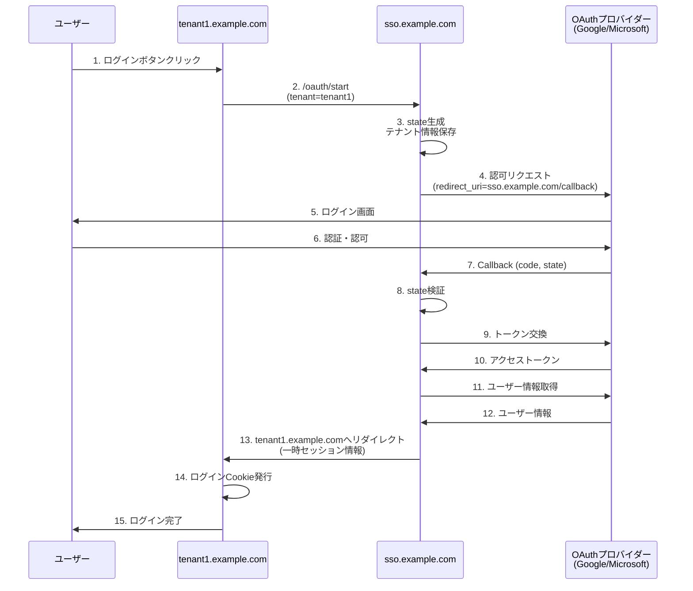

# OAuth 2.0 マルチテナント実装パターン

## 概要

マルチテナントSaaSにおけるOAuth 2.0認証のリダイレクトURI管理パターンを比較する。共通リダイレクトURI + state方式、テナント個別登録方式、ワイルドカード方式の3パターンを解説し、RFC 9700準拠のベストプラクティスをまとめる。

---

## 目次

1. [概要](#概要)
2. [課題: テナントごとに異なるドメイン](#課題-テナントごとに異なるドメイン)
3. [パターン1: 共通リダイレクトURI + state](#パターン1-共通リダイレクトuri--state推奨)
4. [パターン2: テナントごとのリダイレクトURI登録](#パターン2-テナントごとのリダイレクトuri登録)
5. [パターン3: ワイルドカード](#パターン3-ワイルドカード非推奨)
6. [実際のサービスの実装例](#実際のサービスの実装例)
7. [ベストプラクティス](#ベストプラクティス)

---

## 課題: テナントごとに異なるドメイン

### OAuth 2.0のリダイレクトURI制約

OAuth 2.0プロバイダー（Google、Microsoft等）では、セキュリティのため以下の制約があります：

1. **リダイレクトURIは事前登録が必須**
2. **完全一致検証**が行われる
3. **ワイルドカードは非推奨**（RFC 9700）

### 問題点

```
テナントが100個ある場合:
  https://tenant1.example.com/oauth/callback
  https://tenant2.example.com/oauth/callback
  https://tenant3.example.com/oauth/callback
  ...
  https://tenant100.example.com/oauth/callback

すべて事前登録が必要？ → 非現実的
ワイルドカード（*.example.com）を使う？ → セキュリティリスク大
```

---

## パターン1: 共通リダイレクトURI + state（推奨）

**最もスケーラブルで一般的なパターン**

### アーキテクチャ

```
共通認証ドメイン: sso.example.com
テナントドメイン: {tenant}.example.com
```

### フロー図



### 処理の流れ

#### ステップ1: 認可開始（共通認証ドメイン）

1. テナント情報を取得（URLパラメータ、Referer等から）
2. `state`をランダム生成（UUID推奨）
3. セッションストアに保存:
   ```
   key: state (例: "3d89a5ff-0007-4f96-b267-6dbc53f84032")
   value: {
     tenant: "tenant1",
     returnUrl: "https://tenant1.example.com/dashboard",
     createdAt: "2026-01-19T10:00:00Z",
     expiresAt: "2026-01-19T10:05:00Z"
   }
   ```
4. **重要**: Cookieを発行（`domain = .example.com`）
   ```
   Set-Cookie: oauth_state=3d89a5ff-...;
               Domain=.example.com;
               Secure;
               HttpOnly;
               SameSite=Lax;
               Max-Age=300
   ```
5. OAuthプロバイダーの認可URLにリダイレクト
   ```
   https://accounts.google.com/o/oauth2/v2/auth?
     response_type=code&
     client_id=xxx&
     redirect_uri=https://sso.example.com/oauth/callback&
     scope=openid+email+profile&
     state=3d89a5ff-0007-4f96-b267-6dbc53f84032
   ```

#### ステップ2: Callback処理（共通認証ドメイン）

6. URLパラメータから`code`と`state`を取得
7. **state検証**:
   - セッションストアから取得
   - Cookieから取得
   - 両方が一致することを確認 ← **CSRF対策**
8. トークン交換リクエスト（サーバー間通信）
   ```
   POST https://oauth2.googleapis.com/token
   Content-Type: application/x-www-form-urlencoded

   grant_type=authorization_code&
   code=xxx&
   client_id=xxx&
   client_secret=xxx&
   redirect_uri=https://sso.example.com/oauth/callback
   ```
9. アクセストークン取得
10. ユーザー情報取得
    ```
    GET https://www.googleapis.com/oauth2/v2/userinfo
    Authorization: Bearer {access_token}
    ```
11. 一時セッションを作成:
    ```
    key: "temp_session:" + UUID
    value: {
      email: "user@example.com",
      name: "山田 太郎",
      tenant: "tenant1"
    }
    expiresIn: 60秒（1分）
    ```
12. テナントドメインにリダイレクト
    ```
    Location: https://tenant1.example.com/oauth/complete?session=temp_session_id
    ```

#### ステップ3: テナント側完了処理（テナントドメイン）

13. 一時セッションIDを取得
14. 一時セッション情報を取得（**1回限り使用、取得後削除**）
15. テナント固有のログインセッションを作成
16. テナント固有のログインCookieを発行
    ```
    Set-Cookie: session=xxx;
                Domain=tenant1.example.com;
                Secure;
                HttpOnly;
                SameSite=Lax;
                Max-Age=86400
    ```
17. ダッシュボード等にリダイレクト

### 重要ポイント: Cookie のDomain属性

マルチドメイン環境でCookieを共有するには、Domain属性の設定が必須です。

**Domain属性の動作**:

| Domain属性 | Cookie発行元 | Cookie送信先 |
|-----------|-------------|-------------|
| 未設定 | `sso.example.com` | `sso.example.com`のみ |
| `.example.com` | `sso.example.com` | `sso.example.com`, `tenant1.example.com`, `tenant2.example.com`等すべてのサブドメイン |
| `tenant1.example.com` | `tenant1.example.com` | `tenant1.example.com`のみ |

**推奨設定**:

```
OAuth state用Cookie（短期間、サブドメイン共有）:
  name: oauth_state
  domain: .example.com
  secure: true
  httpOnly: true
  sameSite: Lax
  maxAge: 300秒

ログインセッションCookie（長期間、テナント固有）:
  name: session
  domain: tenant1.example.com （テナント固有）
  secure: true
  httpOnly: true
  sameSite: Lax
  maxAge: 86400秒
```

### メリット

- **スケーラブル**: テナントが増えても設定変更不要
- **管理が容易**: OAuthプロバイダーに登録するリダイレクトURIは1つだけ
- **セキュリティ**: state検証でCSRF対策

### デメリット

- **2段階リダイレクト**: 共通ドメイン → テナントドメインの追加リダイレクトが必要
- **Cookie設定の複雑性**: Domain属性を適切に設定しないと検証できない
- **一時セッション管理**: テナント間の情報引き継ぎに一時セッションが必要

---

## パターン2: テナントごとのリダイレクトURI登録

小規模（テナント数が少ない）場合に使用

### 構成

```
OAuthプロバイダーに登録するリダイレクトURI:
  - https://tenant1.example.com/oauth/callback
  - https://tenant2.example.com/oauth/callback
  - https://tenant3.example.com/oauth/callback
  ... (すべてのテナント)
```

### フロー

```
1. tenant1.example.comで認証開始
   ↓
2. redirect_uri = https://tenant1.example.com/oauth/callback を指定
   ↓
3. OAuthプロバイダーで認証
   ↓
4. tenant1.example.com/oauth/callback
   - state検証
   - トークン交換
   - ログインCookie発行
   - 完了（追加リダイレクト不要）
```

### メリット

- **シンプル**: 1エンドポイントで完結
- **Cookie問題なし**: テナントドメインですべて完結
- **セキュリティ高**: テナント間完全分離

### デメリット

- **スケーラビリティ低**: テナント追加ごとにOAuthプロバイダー設定変更
- **運用コスト高**: 数百〜数千のテナントには不向き
- **登録上限**: プロバイダーによってはリダイレクトURI登録数に上限あり

### 採用例

- **Okta**: テナントごとにリダイレクトURI登録を推奨
- 中小規模のマルチテナントSaaS（テナント数 < 100程度）

---

## パターン3: ワイルドカード（非推奨）

### 構成

```
リダイレクトURI:
  https://*.example.com/oauth/callback
```

### RFC 9700（2025年1月）による警告

> **ワイルドカードパターンは使用すべきでない**
>
> Authorization servers MUST utilize exact string matching except for port numbers in localhost redirection URIs of native apps.

**セキュリティリスク**:

1. **サブドメイン乗っ取り攻撃**
   - 攻撃者が`evil.example.com`を登録できた場合、認可コードを受け取れる

2. **類似ドメイン登録攻撃**
   - `example.com.evil.com`等の類似ドメインでの攻撃

3. **パターンマッチングの複雑性**
   - 実装ミスによる脆弱性の可能性

### 結論

**現在は非推奨。RFC 9700に従い、使用しないこと。**

---

## 実際のサービスの実装例

### Slack

- **パターン**: 共通リダイレクトURI + state
- **構成**:
  - 認証: `slack.com/oauth/callback`
  - リダイレクト先: workspace固有URL（例: `your-workspace.slack.com`）
- **state活用**: workspace情報、戻り先URLをstateに含める

### GitHub

- **パターン**: 共通リダイレクトURI + state
- **構成**:
  - 認証: `github.com/login/oauth/callback`
  - リダイレクト先: organization/userページ
- **state活用**: 戻り先URLをstateに含める

### Shopify

- **パターン**: 共通リダイレクトURI + パラメータ
- **構成**:
  - 認証: `shopify.com/oauth/callback`
  - リダイレクト先: shop固有のadmin URL（例: `your-shop.myshopify.com/admin`）
- **パラメータ活用**: shop情報をURLパラメータに含める

### Auth0

- **パターン**: マネージドサービス（Organizations機能）
- **構成**:
  - テナントごとにOrganizationを作成
  - サブドメインベースのルーティング
  - Auth0がリダイレクトURI管理を担当

---

## ベストプラクティス

### 1. RFC 9700準拠（2025年セキュリティ標準）

- **完全一致検証**: リダイレクトURIは完全一致で検証
- **ワイルドカード禁止**: `*.example.com` は使用しない
- **state必須**: すべてのフローでstate検証を実装
- **HTTPS必須**: すべての通信でHTTPSを使用

### 2. Cookie設定

マルチドメイン対応Cookieの推奨設定:

```
OAuth一時Cookie:
  - name: oauth_state
  - domain: .example.com （先頭のドット重要）
  - secure: true （HTTPS必須）
  - httpOnly: true （XSS対策）
  - sameSite: Lax （CSRF対策）
  - maxAge: 短期間（300秒程度）

ログインセッションCookie:
  - name: session
  - domain: {tenant}.example.com （テナント固有）
  - secure: true
  - httpOnly: true
  - sameSite: Lax
  - maxAge: 長期間（86400秒程度）
```

### 3. セキュリティチェックリスト

- [ ] stateパラメータの検証を**必ず**実装している
- [ ] CookieのDomain属性を適切に設定している
- [ ] サブドメイン間でのstate検証を確認している
- [ ] 一時セッションは短期間（1分以内）で有効期限切れになる
- [ ] リダイレクト先URLのホワイトリスト検証を実装している
- [ ] 認可コードは1回限り使用で無効化している
- [ ] アクセストークンをログに出力していない
- [ ] すべての通信でHTTPSを使用している

### 4. テナント分離

セキュリティ境界を明確にする:

```
認証フロー:
  - 共通ドメイン（sso.example.com）で実施
  - state検証必須
  - トークン交換はサーバー間通信

セッション管理:
  - テナント固有ドメイン（{tenant}.example.com）で実施
  - テナントごとに独立したセッション
  - Cookie domainはテナント固有

データ保存:
  - テナントごとに完全分離
  - データベーススキーマ分離またはマルチテナント対応
```

### 5. パターン選択基準

| テナント数 | 推奨パターン | 理由 |
|----------|-------------|------|
| 1-10 | パターン2（個別登録） | シンプルで管理しやすい |
| 10-100 | パターン1または2 | 運用コストとスケーラビリティのバランス |
| 100+ | パターン1（共通URI） | スケーラビリティ必須 |
| エンタープライズ | Auth0/Oktaマネージドサービス | セキュリティと運用の両立 |

---

## まとめ

### マルチテナント環境でのOAuth実装の鉄則

1. **パターン1（共通リダイレクトURI + state）が最もスケーラブル**
2. **CookieのDomain属性設定が重要**（`.example.com`でサブドメイン共有）
3. **state検証は必須**（CSRF対策）
4. **ワイルドカードは使用しない**（RFC 9700準拠）
5. **一時セッションは短期間で無効化**（セキュリティ）

### よくある実装ミス

- CookieのDomain属性未設定 → サブドメインでstate検証できない
- ワイルドカード使用 → セキュリティリスク大
- state検証の省略 → CSRF攻撃の可能性
- 一時セッションの長期保持 → セッションハイジャックリスク

---

## 参考リンク

### 公式仕様

- [RFC 6749 - OAuth 2.0 Authorization Framework](https://datatracker.ietf.org/doc/html/rfc6749)
- [RFC 9700 - OAuth 2.0 Security Best Current Practice](https://datatracker.ietf.org/doc/rfc9700/) - 2025年1月公開
- [OAuth.net - Authorization Code Grant](https://oauth.net/2/grant-types/authorization-code/)

### マルチテナント関連

- [Auth0 - Multi-Tenant SaaS Best Practices](https://auth0.com/docs/manage-users/organizations/multi-tenant-applications)
- [Microsoft - Redirect URI Best Practices](https://learn.microsoft.com/en-us/entra/identity-platform/reply-url)
