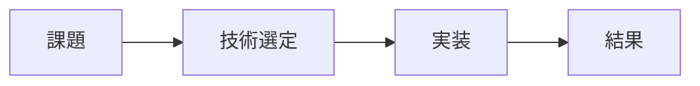

# 技術記事の書き方ベストプラクティス

## 概要

エンジニアが技術記事（Zenn / Qiita / 個人ブログ等）を書く際の構成・タイトル・読みやすさのコツをまとめる。AI検索時代（2026年）に対応した記事構造の変化も含む。

---

## 1. 設計フェーズ — 書き始める前に決めること

記事の質は「設計」でほぼ決まる。書く前に以下を明文化する。

### 1-1. 「課題 : 技術」の対比で軸を決める

技術記事は **解決したい課題** と **使う技術** の対比で組み立てる。

| 悪い軸 | 良い軸 |
|--------|--------|
| 「React Hooksについて」 | 「フォーム状態管理で再レンダリングが多発する問題を `useReducer` で解決する」 |
| 「Docker入門」 | 「ローカル開発のNode.jsバージョン差異を Docker Compose で吸収する」 |

課題と技術が1対1で結ばれていると、タイトル・構成・本文すべてがブレない。

### 1-2. 対象読者と前提を明示する

冒頭で「誰向けか」「何を知っている前提か」を書く。これだけで離脱率が下がる。

```markdown
:::message
**対象読者**
- React フックを使い始めたばかりの人
- フォームの再レンダリング問題で詰まっている人

**前提知識**
- useState の基本的な使い方
:::
```

## 2. タイトルの付け方

### 2-1. 検索キーワードを必ず含める

タイトルは検索の入口。**読者が検索しそうな言葉**を必ず含める。

- ❌ 「先週ハマった話」
- ✅ 「Next.js App Router で `useSearchParams` が `null` になる原因と対策」

### 2-2. 課題 → 解決のフォーマット

定番フォーマット：

> 「（解決技術）で（課題）を解決する」
> 「（技術）における（問題）の原因と対策」
> 「（技術）を試して分かった（数字）つのこと」

### 2-3. 文字数とキーワード位置

- 50〜70文字程度（SEOと一覧表示の両立）
- **重要キーワードは前半に**配置

## 3. 記事の構成

### 3-1. 推奨フロー（2026年版）

AI検索（ChatGPT, Perplexity, Google AI Overview等）の台頭で、**結論を冒頭に置く構成**が必須化している。AIは記事の上部しか読まない傾向があるため。

```
1. 対象読者・前提
2. 結論（成果・スクショ・最終コード）   ← AI時代は上に持ってくる
3. 手順（実装ステップ）
4. 背景・理由（なぜそうするか）
5. 落とし穴・ハマりどころ
6. まとめ・次のステップ
7. 参考リンク
```

従来の起承転結（結論を最後）は SEO・AI 検索の両面で不利になりつつある。

### 3-2. 見出し階層のルール

- **h1 は1ファイルに1つだけ**（タイトルと一致）
- h2 を主見出し、h3 を補助に
- h4 以下はなるべく使わない（読みづらい）
- **長い記事（1,000語以上）は目次を入れる**（Zennは自動生成あり）

## 4. 本文の書き方

### 4-1. 「文章 → 見出し → コード → 図」の順

ブロックの順番を意識すると一気に読みやすくなる。

1. **文章**で文脈を作る
2. **見出し**でセクションを切る
3. **コード**で具体例を示す
4. **図**で関係を可視化する

### 4-2. 1見出し1テーマ・5行ルール

- 1つの見出し配下は **長くて5行程度** に留める
- それ以上書きたくなったら、別の見出しに切る
- 「節を短く、見出しを多く」が読みやすさの王道

### 4-3. コードブロックは最小・実行可能

- 関係ない import やコメントは削る
- ただし **コピペで動く** ことは保証する
- 言語指定（` ```ts ` 等）を必ず付ける

### 4-4. 図解・スクショを惜しまない

- アーキテクチャ図、フロー図、状態遷移図 → Mermaid 推奨（Zenn対応）
- UI関連はスクショ必須
- 「文字で読む量」と「図で見る量」のバランスを意識



## 5. 読みやすさを上げる小技

| 技 | 効果 |
|-----|------|
| 表で比較する | パッと差分が分かる |
| 引用ブロック (`>`) で重要点を強調 | 視覚的アクセント |
| `:::message` / `:::message alert` (Zenn) | 注意喚起 |
| 絵文字を**見出しに**控えめに | リズム作り（本文に乱用は逆効果） |
| 番号付きリスト | 手順は箇条書きより番号 |
| 太字は**1段落に1つまで** | 強調が効く |

## 6. AI検索時代の追加考慮事項（2026年〜）

### 6-1. 著者プロフィールを明記する

GoogleのEEATフレームワークやAIエンジンは**著者の信頼性**を評価する。

- 記事末尾やプロフィール欄に **経歴・専門性** を一文入れる
- AIは著者名を LinkedIn / GitHub と突合する傾向

### 6-2. H1は自然言語クエリ形式に

AIが「直接の回答」として取り出しやすい形にする。

- ❌ 「Next.js useSearchParams null 問題」
- ✅ 「Next.js App Router で useSearchParams が null になるのはなぜか」

### 6-3. AI執筆を使った場合は明記

AI下書き → 人間レビュー、というワークフローを使った場合は **冒頭に明記**するのが誠実かつ評価される。

```markdown
:::message
本記事は Claude に下書きを生成させ、筆者が事実確認・構成調整・加筆修正を
行ったものです。
:::
```

## 7. 公開前チェックリスト

- [ ] タイトルに検索キーワードが含まれているか
- [ ] 冒頭で対象読者・前提を明示しているか
- [ ] 結論・成果が記事の上部にあるか
- [ ] コードはコピペで動くか
- [ ] 図・表で視覚的に補強しているか
- [ ] 1見出し配下が長すぎないか（5行ルール）
- [ ] 誤字脱字・コードの言語指定漏れ
- [ ] 参考リンクをまとめてあるか
- [ ] AI下書きを使った場合は明記したか

## 8. プラットフォーム別の小技

### Zenn

- フロントマター: `title`, `emoji`, `type` (tech/idea), `topics`, `published`
- `:::message` `:::message alert` でメッセージブロック
- Mermaid 標準対応
- GitHub連携でローカル執筆可（`zenn-cli`）

### Qiita

- タグ最大5つ、人気タグを選ぶと露出が増える
- LGTM数がSEOに効く

### 個人ブログ

- 自由度高いがSEO設計を自分でやる必要あり
- カノニカルURL・OGP・サイトマップは最低限整える

## 参考リンク

- [本気で技術記事を書く時のプロセス (Zenn)](https://zenn.dev/seya/articles/47ecabce77d68c)
- [技術記事を書くための知見 (Zenn)](https://zenn.dev/hironobu0824/articles/tech_blog_tips)
- [自分の技術記事の構成 & 読みやすさのための意識 (Zenn)](https://zenn.dev/akuad/articles/my-article-writing)
- [世界一見られる技術ブログの書き方【テンプレート有】 (Zenn)](https://zenn.dev/renn/articles/454ea916a29236)
- [伝えたい人に届ける技術記事の書き方 (Qiita)](https://qiita.com/MinoDriven/items/6718b5e70e3fb321ff9b)
- [Zennで開発者に届く記事の書き方フロー (note)](https://note.com/intern_invest/n/n3958d552f243)
- [What Does an Ideal Blog Post Look Like in 2026? (SEO + AI Guide)](https://rebeccavandenberg.com/what-does-an-ideal-blog-post-look-like-in-2026-seo-ai-guide/)
- [Developer-Friendly Blog Post Structure (DevRel Bridge)](https://devrelbridge.com/blog/developer-friendly-blog-post-structure)
- [Technical Writing: A Comprehensive Guide (2026)](https://www.adoc-studio.app/blog/technical-writing-guide)
