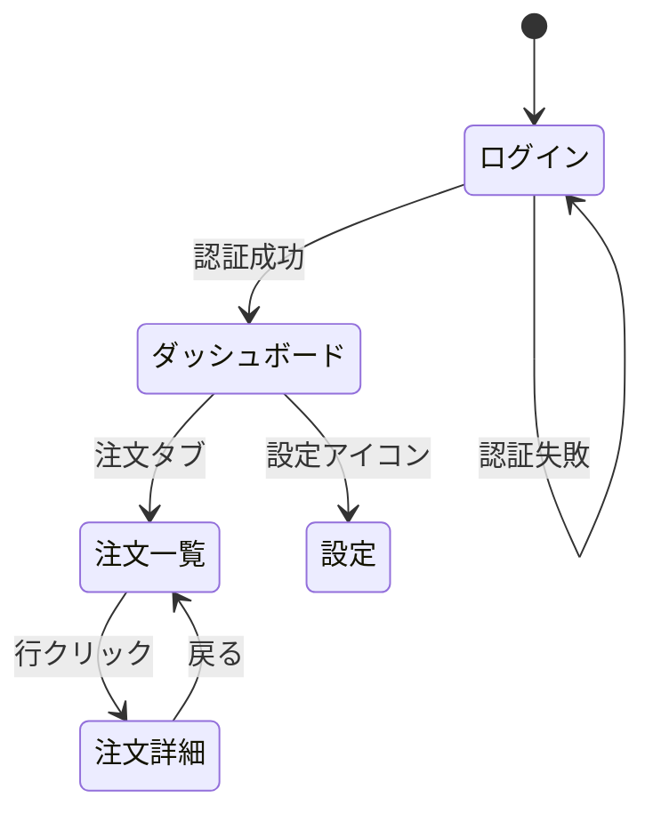
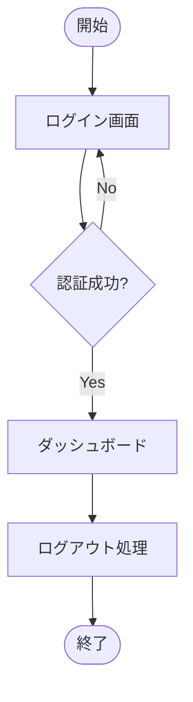
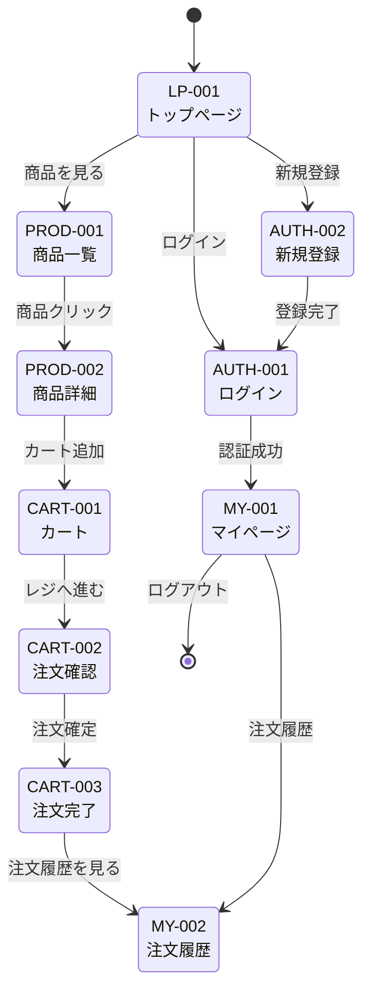
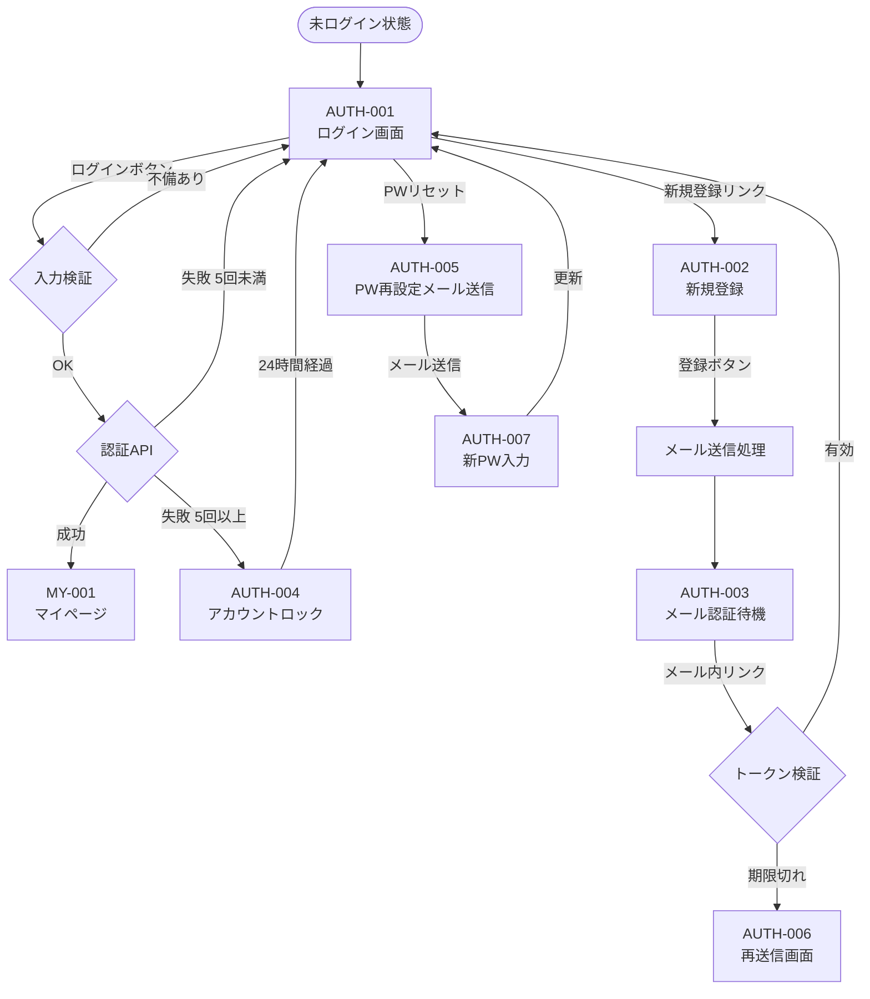
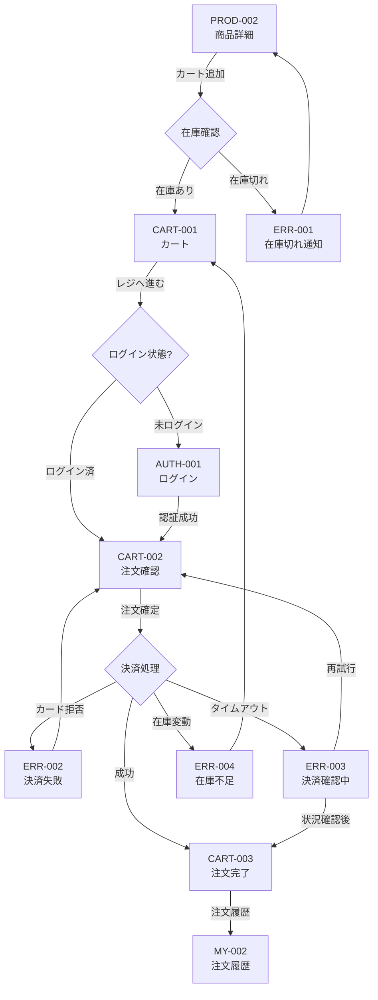
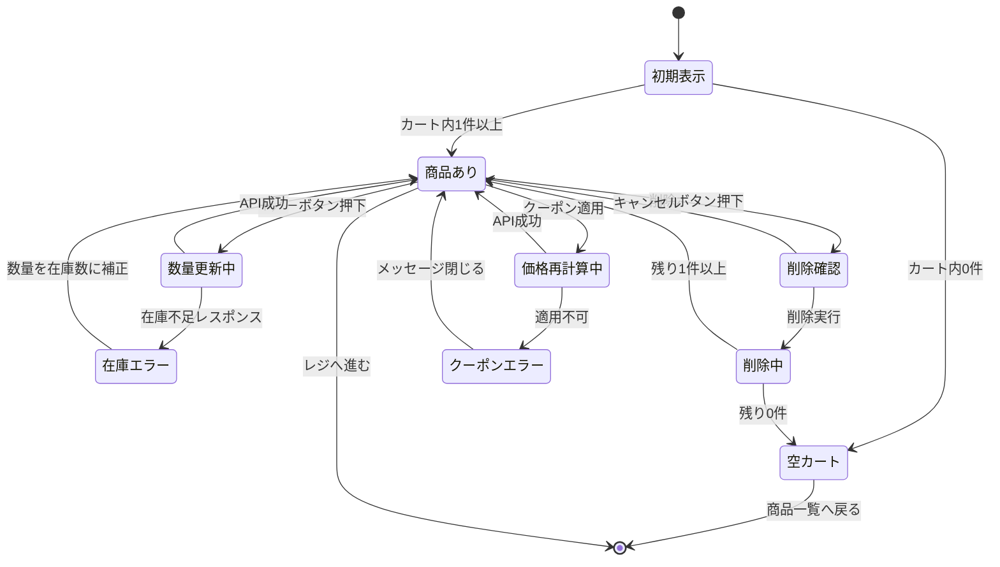

# 画面遷移図ベストプラクティス

## 概要

開発における画面遷移図の作り方・運用の指針をまとめた記事。Diagrams as Code を中心に、図の粒度・更新運用・既存プロジェクトへの後付け導入まで扱う。Figma導入が途中からのプロジェクトや、画面遷移図が未整備のプロジェクトでも破綻しない現実的なアプローチを示す。

---

## 1. 基本原則

### 1.1 Diagrams as Code を使う

GUIツール単体（Figma、PowerPoint等）で作るとレビュー・差分管理ができない。**テキストでrepo管理**できる形式を採用する。

| ツール | 特徴 | 推奨度 |
|---|---|---|
| **Mermaid** | GitHub/Obsidianで即プレビュー、軽量 | ◎ 開発文脈ではほぼこれでOK |
| **PlantUML** | 細かい制御が効く。activity/state diagram | ○ より複雑な図が必要な場合 |
| **draw.io (.drawio.svg)** | GUI操作だがXMLで差分は確認可能 | △ デザイン重視の図向け |
| **Figma + FigJam** | デザイナーと共有しやすい | △ diff不可、設計フェーズ向け |

開発文脈なら **Mermaid 一択**でほぼ事足りる。GitHub/Obsidian/Docsifyで直接プレビューできる利点が大きい。

### 1.2 図の粒度を分ける

1枚に詰め込まない。レイヤを分ける。

- **L1: 全体俯瞰図** — 主要画面・主要フローのみ（5〜15画面程度）
- **L2: 機能別フロー図** — 申込フロー、認証フロー、決済フロー等
- **L3: 状態遷移図** — 1画面内の状態（フォームのvalidation states等）

L1だけあれば会話の解像度が大きく上がる。L2/L3は必要になったタイミングで追加すればよい。

### 1.3 遷移には「トリガー」を必ず書く

```
画面A --[ボタンX押下]--> 画面B
画面A --[セッション切れ]--> ログイン画面
```

矢印だけで条件・トリガーが書かれてない図は使い物にならない。**何をしたら何が起きるか**が読み取れる粒度で書く。

### 1.4 異常系・条件分岐を省略しない

ハッピーパスだけの図は実装で詰む。最低限以下は明示する。

- エラー画面遷移
- 権限なしの場合のリダイレクト
- 入力バリデーションNG時
- セッションタイムアウト
- 通信エラー時の戻り先

### 1.5 画面IDで命名統一

画面に `SCR-001`、`LOGIN_001` 等のIDを振り、以下と紐付ける。

- 画面遷移図のノード名
- ルーティング定義（URL）
- 仕様書のセクション
- テストケースID

これにより「あの画面」「この画面」の指示語が消え、議論の齟齬が減る。

### 1.6 図と画面仕様書を分離する

画面遷移図には「**どこからどこへ・条件は何か**」だけを書く。画面の中身（項目・バリデーション・表示ロジック）は別ドキュメント（画面仕様書）に分離する。

混ぜると図が肥大化して誰も読まなくなる。

---

## 2. Mermaid記法の使い分け

### 2.1 stateDiagram-v2（画面=状態として捉える）



- 全体俯瞰図やシンプルな遷移に向く
- `[*]` で開始・終了状態を表現できる
- 双方向遷移が描きやすい

### 2.2 flowchart（条件分岐を明示したい時）



- 分岐条件（`{条件?}`）を明示できる
- フローチャート寄りで業務フロー記述に向く
- decision diamond / start-end の表現が可能

### 2.3 使い分け基準

- **画面間の関係性を俯瞰したい** → stateDiagram-v2
- **業務フローの判断ロジックを示したい** → flowchart
- **画面内の状態変化を示したい** → stateDiagram-v2

---

## 3. 既存プロジェクトへの後付け導入

Figmaが途中から導入された、画面遷移図がそもそもない、というプロジェクトに後から整備する場合のアプローチ。

### 3.1 完璧主義を捨てる

**「全画面網羅」を最初の目標にしない**。一気に整備しようとすると挫折する。「触る範囲から埋める」が破綻しない唯一の道。

### 3.2 Phase 1: 棚卸し（1〜2日）

実装から逆算してリストを作る。デザインから作ろうとすると終わらない。

- ルーティング定義（React Router / Next.js routes / Rails routes.rb 等）からURL一覧を抽出
- スプレッドシート/Notionで管理: `URL / 画面名 / 画面ID / Figma有無 / 遷移図有無 / 仕様書有無 / 担当`
- 「あるべき」じゃなくて「**ある**もの」を起点に列挙する

### 3.3 Phase 2: 全体俯瞰図だけ先に作る（1日）

全画面の詳細は不要。L1（主要画面15個程度）のMermaid図を1枚repoに置く。

- 主要画面ノード + 主要遷移だけ
- 詳細未定の画面は `[仮: 注文編集]` 等で書いておく
- これがあるだけで会話の解像度が劇的に上がる

### 3.4 Phase 3: 改修駆動で埋める（継続）

**「画面遷移図を整備するプロジェクト」を立てない。負ける。**

新機能追加・改修のPRごとに、関係する範囲だけ図を追加・更新するルールにする。

- 改修対象画面のFigma化（その範囲だけ）
- 改修対象フローの遷移図追加（その範囲だけ）
- PRテンプレートに「画面遷移図の更新有無」チェック項目を追加

このやり方だと半年〜1年で**よく触る画面から自然に埋まっていく**。触らない画面は永遠に埋まらないが、それは**触らないから優先度が低い**ということ。

### 3.5 Phase 4: ギャップ可視化

棚卸しスプレッドシートで「カバー率」をモニタリング。経営/PMに見せる時の説得材料にもなる。

```
全画面: 80
Figma有: 30 (37%)
遷移図記載: 25 (31%)
仕様書: 45 (56%)
```

### 3.6 Figmaなし画面の扱い

全部Figma化するのは現実的じゃない。**画面の重要度で分ける**。

- **コア画面**（ログイン・申込・決済等）: Figma化 + 遷移図必須
- **管理画面・社内ツール**: Figma不要、**スクリーンショット + Markdown仕様**で十分
- **設定系の地味な画面**: 遷移図ノードだけ存在すればOK、絵は省略

---

## 4. やりがちな失敗

| 失敗 | 対策 |
|---|---|
| 1枚に全画面詰め込んで誰も読まない | L1/L2/L3 でレイヤを分ける |
| ハッピーパスしか書いてない | 異常系・分岐・タイムアウトを必ず含める |
| 矢印に条件・トリガーが書かれてない | 全矢印にラベル必須をルール化 |
| 図が更新されず実装と乖離 | Diagrams as Code + PR差分でレビュー対象にする |
| 画面ID命名が図・コード・仕様書でバラバラ | 命名規則を最初に決める（`SCR-001` 等） |
| 「整備プロジェクト」を立てて頓挫 | 改修駆動で少しずつ埋める |

---

## 5. 運用ルール例（PRテンプレートへの組み込み）

```markdown
## 画面変更チェック

- [ ] 画面遷移図の更新が必要 → `docs/screens/transition.md` を更新済み
- [ ] 画面遷移図の更新は不要（既存遷移を変えていない）
- [ ] 新規画面追加 → 画面ID採番済み（`SCR-XXX`）
- [ ] 異常系遷移（エラー・タイムアウト・権限なし）を遷移図に反映済み
```

このチェック項目があるだけで、レビュアーが図の更新漏れを指摘しやすくなる。

---

---

## 6. 実例: 仮想ECサイトでの設計

仮想のECサイト「BookShop」を題材に、L1/L2/L3 各レイヤの設計例を示す。

### 6.1 画面ID命名規則

このプロジェクトでは以下の命名規則を採用する。

| プレフィックス | 領域 |
|---|---|
| `LP-XXX` | ランディング・公開ページ |
| `AUTH-XXX` | 認証関連（ログイン・登録・PWリセット） |
| `PROD-XXX` | 商品系（一覧・詳細・検索） |
| `CART-XXX` | カート・注文 |
| `MY-XXX` | マイページ・会員領域 |
| `ADMIN-XXX` | 管理者領域 |

### 6.2 L1: 全体俯瞰図（主要画面のみ）

主要画面と主要遷移だけ。詳細フローや異常系の枝は省略し、システム全体の構造を一目で掴むことを優先する。



**ポイント**:
- 1枚で**主要10画面・主要遷移**だけ。これ以上詰めない
- 全画面網羅は目指さない（設定画面・利用規約等は省略）
- ノードラベルに `画面ID + 画面名` を併記して仕様書と紐付け可能に

### 6.3 L2: 機能別フロー図 - 認証フロー

異常系・条件分岐を含む。L1には書ききれなかった「メール認証」「パスワード再設定」等の枝を網羅する。



**ポイント**:
- **異常系を全部書く**: アカウントロック、メール期限切れ、トークン期限切れ等
- 矢印すべてに**トリガーラベル**を付ける（"ログインボタン"、"5回未満"等）
- 判定ロジックは `{条件?}` でひし形ノードに

### 6.4 L2: 機能別フロー図 - 購入フロー

決済の異常系を意識的に含める。ECで一番事故りやすい領域。



**ポイント**:
- 決済の異常系を**4種類**明示（カード拒否・タイムアウト・在庫変動・成功）
- 「未ログイン状態でレジへ進む」のリダイレクトを書く
- エラー画面は `ERR-XXX` 系IDで統一

### 6.5 L3: 状態遷移図 - カート画面

1画面内の状態変化を表現。フォームのバリデーション、非同期更新中、エラー表示などを記述する。



**ポイント**:
- 非同期処理の中間状態（"数量更新中"、"削除中"、"価格再計算中"）を**明示する**
- エラー状態（"在庫エラー"、"クーポンエラー"）も独立した状態として表現
- これがあるとフロントエンド実装時の useState/Reducer 設計が明確になる

### 6.6 ファイル配置例

```
docs/
└── screens/
    ├── README.md              # 画面ID一覧・命名規則
    ├── L1_overview.md         # L1全体俯瞰図
    ├── L2_auth_flow.md        # L2認証フロー
    ├── L2_purchase_flow.md    # L2購入フロー
    ├── L3_cart_states.md      # L3カート状態遷移
    └── screens/
        ├── LP-001.md          # 各画面の仕様書（個別）
        ├── AUTH-001.md
        └── ...
```

repo直下の `docs/screens/` に図と仕様書を配置。Mermaidは Markdown内に直接書けるので、画像生成不要・差分レビュー可能。

---

## 参考リンク

- [Mermaid公式ドキュメント](https://mermaid.js.org/)
- [Mermaid stateDiagram](https://mermaid.js.org/syntax/stateDiagram.html)
- [Mermaid flowchart](https://mermaid.js.org/syntax/flowchart.html)
- [PlantUML](https://plantuml.com/)
- [draw.io / diagrams.net](https://www.drawio.com/)
